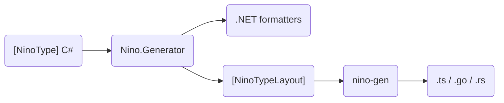

<AnchorRedirect map={{ 'example': '/en/docs/v4/advanced/typescript#example', 'with-aspnet-core': '/en/docs/v4/advanced/typescript#with-aspnet-core', 'api': '/en/docs/v4/advanced/typescript#api', 'text-in-browsers': '/en/docs/v4/advanced/typescript#text-in-browsers', 'type-mapping': '/en/docs/v4/advanced/typescript#type-mapping', 'typed-arrays': '/en/docs/v4/advanced/typescript#typed-arrays', 'not-supported': '/en/docs/v4/advanced/typescript#not-supported', 'performance': '/en/docs/v4/advanced/typescript#performance', 'compared-with-memorypack': '/en/docs/v4/advanced/typescript#compared-with-memorypack', 'from-ninotypescript': '/en/docs/v4/advanced/typescript#from-ninotypescript', 'typescript': '/en/docs/v4/advanced/typescript', 'compared-with-json': '/en/docs/v4/advanced/typescript#performance', 'go': '/en/docs/v4/advanced/go', 'go-generated-code': '/en/docs/v4/advanced/go#generated-code', 'struct-tags': '/en/docs/v4/advanced/go#struct-tags', 'go-strings': '/en/docs/v4/advanced/go#strings', 'go-values': '/en/docs/v4/advanced/go#values', 'rust': '/en/docs/v4/advanced/rust', 'rust-generated-code': '/en/docs/v4/advanced/rust#generated-code', 'rust-types': '/en/docs/v4/advanced/rust#types', 'rust-values': '/en/docs/v4/advanced/rust#values', 'rust-derive': '/en/docs/v4/advanced/rust#derive', 'rust-hand-written': '/en/docs/v4/advanced/rust#hand-written', 'rust-features': '/en/docs/v4/advanced/rust#features' }} />

Nino writes your `[NinoType]`s as **TypeScript**, **Go** or **Rust**: one type per `[NinoType]`, with codecs that read and write exactly the bytes Nino writes in .NET. A browser, a Node server, a Go service or a Rust program then exchanges the same bytes as your .NET code, without a .NET runtime. The generator is **nino-gen**, and it comes in two packages with the same options and the same output:

- **Nino.Codegen**, a build package: after each compile of the project that references it, it writes what the project's `<NinoCodegen>` items ask for ([In a Build](#setup)).
- **Nino.Codegen.Tool**, the `nino-gen` .NET tool, for a built assembly from the command line, a script or a CI step. It also writes and checks a [layout baseline](/en/docs/v4/evolving-data#layout-baseline) and [shows what each byte of a message is](#inspect) ([From the Command Line](#command-line)).

```xml title="Shop.Contracts.csproj"
<ItemGroup>
  <NinoCodegen Include="typescript" Out="../web/src/model" ImportExtension=".js" />
  <NinoCodegen Include="go" Out="../server/model" Package="model" Tags="json" />
  <NinoCodegen Include="rust" Out="../client/src" Name="model.rs" Serde="true" />
</ItemGroup>
```

Each language has a page of its own, and a runtime next to the generated code that every release publishes with Nino's version ([runtimes/](https://github.com/JasonXuDeveloper/Nino/tree/main/runtimes)):

| Language | Runtime | Needs |
| --- | --- | --- |
| [TypeScript](/en/docs/v4/advanced/typescript) | `nino.ts`, written next to the code, or the npm package `nino-serialization` ([`Runtime`](#options)) | TypeScript 5.7 or later, an ES2022 environment: a current browser, or Node 15 or later |
| [Go](/en/docs/v4/advanced/go) | the module `github.com/JasonXuDeveloper/Nino/runtimes/go/v4` (package `nino`) | Go 1.22 or later, nothing outside the standard library |
| [Rust](/en/docs/v4/advanced/rust) | the crate `nino-serialization` (library `nino`), with its `indexmap` feature unless [`Maps="std"`](#options) | Rust 1.88 or later |

<Callout type="info" title="Requirements">

nino-gen runs on .NET 8 or later (in a build, the SDK's runtime), whatever the project's target framework. It reads the byte encodings the generator publishes in the layout metadata.

</Callout>

## How It Works [#how-it-works]



- **From the built assembly.** nino-gen reads only the `[assembly: NinoTypeLayout]` attributes (the [layout metadata](/en/docs/v4/evolving-data#layout-metadata)) that the generator publishes in every assembly it compiles, without loading the assembly or its references: it needs no source and runs no code. It writes the assembly's `[NinoType]`s and those of referenced assemblies that they use.
- **The same layouts as the formatters.** The generator writes each layout from the same model as the type's C# formatter, so the generated code reads and writes the members in the order, encoding and format the .NET code uses. Every decision about the bytes is made once, for all three languages.
- **Quiet on unchanged builds.** A file is written only when its text changes, and an item runs again only when the assembly, its references, the tool or the item's metadata change, never in the IDE's design-time builds.
- **Stale files are deleted.** The files a run writes are listed in `.nino-gen` in the output directory, and the next run deletes those it no longer writes (after a renamed assembly, a new `Name`, or `Runtime` given). Other files in the directory are left alone.

## In a Build [#setup]

<Steps>
<Step>

### Add the package [#add-the-package]

Add it to the project that declares your `[NinoType]`s, or to a project that references them (a server project): the generated code holds the types of the assembly and of the assemblies it references.

```shell
dotnet add Shop.Contracts package Nino --prerelease
dotnet add Shop.Contracts package Nino.Codegen --prerelease
```

Nino.Codegen is a development dependency: `dotnet add package` marks it `PrivateAssets="all"`, it adds nothing to your build output, and projects that reference yours do not inherit it (they declare their own items if they want their own types written).

```xml title="Shop.Contracts.csproj"
<PackageReference Include="Nino.Codegen" Version="..." PrivateAssets="all" />
```

</Step>
<Step>

### Declare what to write [#declare-items]

One `<NinoCodegen>` item per output. The item is the language (`typescript` or `ts`, `go`, `rust`); every other metadata is a [nino-gen option](#options). Two items of one language with different `Out`s write twice.

```xml title="Shop.Contracts.csproj" tab="TypeScript" tab-group="codegen-lang"
<ItemGroup>
  <NinoCodegen Include="typescript" Out="../web/src/nino" ImportExtension=".js" />
</ItemGroup>
```

```xml title="Shop.Contracts.csproj" tab="Go" tab-group="codegen-lang"
<ItemGroup>
  <NinoCodegen Include="go" Out="../server/protocol" Package="protocol" />
</ItemGroup>
```

```xml title="Shop.Contracts.csproj" tab="Rust" tab-group="codegen-lang"
<ItemGroup>
  <NinoCodegen Include="rust" Out="../client/src" Serde="true" />
</ItemGroup>
```

A project that references the package without an item gets warning [NINOGEN004](#diagnostics) and writes nothing.

</Step>
<Step>

### Build [#build]

```shell
dotnet build Shop.Contracts
# nino-gen: Shop.Contracts.ts, nino.ts -> .../web/src/nino
```

Without `Out`, the files go to `ts/`, `go/` or `rust/` next to the project file. Commit them if the other side is built without running `dotnet build` first.

</Step>
<Step>

### Use them [#use-them]

Each language's page shows the code nino-gen writes and how to call it: [TypeScript](/en/docs/v4/advanced/typescript#example), [Go](/en/docs/v4/advanced/go#generated-code), [Rust](/en/docs/v4/advanced/rust#functions).

</Step>
</Steps>

### Options [#options]

Each metadata of a `<NinoCodegen>` item is the nino-gen option of the same name in PascalCase (MSBuild reserves the metadata name `Output`, hence `Out`):

| Metadata | Option | Language | Default | |
| --- | --- | --- | --- | --- |
| `Out` | `--out` | all | `ts/`, `go/` or `rust/` next to the project | The directory to write to, relative to the project. |
| `Name` | `--name` | all | `<Assembly>.ts`, `nino_types.go`, `nino_types.rs` | The generated file's name. |
| `Names` | `--names` | TypeScript | `camel` | `camel` writes member names in camelCase (`UnitPrice` → `unitPrice`, `URL` → `url`); `keep` keeps them as in C#. |
| `ImportExtension` | `--import-extension` | TypeScript | empty | The extension of the generated file's import of `nino.ts`: empty for bundlers (Vite, webpack, esbuild), `.js` for Node ESM compiled with `tsc`, `.ts` for Deno and Node's type stripping, or `.mjs`, `.mts`. |
| `Runtime` | `--runtime` | TypeScript | empty | Import the runtime from this module instead of writing `nino.ts` next to the code. |
| `NumericArrays` | `--numeric-arrays` | TypeScript | `plain` | `plain`: arrays and lists of numbers are `number[]` (`bigint[]` for 64-bit integers). `typed`: [typed arrays](/en/docs/v4/advanced/typescript#typed-arrays) (`Int32Array`, `Float64Array`...). |
| `Package` | `--package` | Go | the assembly name's letters and digits, lower-cased | The package name. |
| `Tags` | `--tags` | Go | `json,yaml` | The struct tags written after `nino`, in order. For none: `--tags ""` on the command line, `Tags=","` in a build (an empty `Tags` is the same as none set, which takes the default). |
| `TagNames` | `--tag-names` | Go | `camel` | How those tags name a member: `camel`, `snake` or `original`. |
| `Serde` | `--serde` | Rust | `false` | `true` adds `#[cfg_attr(feature = "serde", derive(serde::Serialize, serde::Deserialize))]` and a rename per field. |
| `SerdeNames` | `--serde-names` | Rust | `camel` | The serde names: `camel` (as `System.Text.Json` names them), `snake` or `original`. |
| `Strings` | `--strings` | Rust | `string` | `string`: C# strings are `String`. `wide`: `nino::WideString`, which keeps an unpaired surrogate ([Types](/en/docs/v4/advanced/rust#types)). |
| `Maps` | `--maps` | Rust | `indexmap` | `indexmap`: dictionaries and sets are `IndexMap` and `IndexSet`, which keep the order they were read in. `std`: `HashMap` and `HashSet`, with no dependency but the crate, written in an order that differs from .NET's ([Install](/en/docs/v4/advanced/rust#install)). |

The build passes the assembly it compiled and its references itself. nino-gen checks the metadata as it checks the command line: an option of another language, or a value it does not take, fails the build with [NINOGEN001](#diagnostics).

`TagNames` and `SerdeNames` name a member from its C# name. `camel` lower-cases the leading run of capitals, keeping the last one when a lower-case letter follows: `Health` → `health`, `ID` → `id`, `URLPath` → `urlPath`, `I128` → `i128`, `Utf8A` → `utf8A`. `snake` joins the words with `_` in lower case, digits staying with the word before them: `IntList` → `int_list`, `URLPath` → `url_path`, `I128` → `i128`, `Utf8A` → `utf8_a`. `original` keeps the C# name. The `nino` tag of a Go field always holds the C# name as it is.

| Property | Default | |
| --- | --- | --- |
| `NinoCodegenTargetFramework` | the first in `TargetFrameworks` | With several target frameworks, the one whose build writes the files. |
| `NinoCodegenEnabled` | `true` | `false` turns it off. |

## From the Command Line [#command-line]

The `nino-gen` tool reads a built assembly's layouts and has three commands:

| Command | What it does | |
| --- | --- | --- |
| `nino-gen --assembly <dll> --lang ts\|go\|rust` | Writes the TypeScript, Go or Rust code, as a build does. | below |
| `nino-gen layouts --assembly <dll> --out NinoLayouts.cs [--check]` | Writes the [layout baseline](/en/docs/v4/evolving-data#layout-baseline) of the assembly's types; with `--check`, compares the assembly with it and exits with 1 on a change that breaks old data (NINO034, NINO035). | [Layout Baseline](/en/docs/v4/evolving-data#layout-baseline) |
| `nino-gen inspect --assembly <dll> --type <name> [<file>]` | Prints what each byte of one message is. | [Inspecting a Message](#inspect) |

```shell
dotnet tool install -g Nino.Codegen.Tool --prerelease
dotnet publish -c Release -o publish   # the assembly with its dependencies, Nino.Core.dll among them
nino-gen --assembly publish/Shop.Contracts.dll --lang go --out ../server/protocol
nino-gen layouts --assembly publish/Shop.Contracts.dll --out Shop.Contracts/NinoLayouts.cs --check
```

Each command takes `--references` (below) and prints its usage with `--help`. The rest of this section is code generation:

```text
nino-gen --assembly <dll> --lang ts|go|rust --out <dir> [--references <file>] [--name <file name>]
  ts:   [--names camel|keep] [--import-extension <.js|.ts|.mjs|.mts>] [--runtime <module>] [--numeric-arrays plain|typed]
  go:   [--package <name>] [--tags json,yaml] [--tag-names camel|snake|original]
  rust: [--serde] [--serde-names camel|snake|original] [--strings string|wide] [--maps indexmap|std]
```

The options are those of the [table above](#options), plus:

| Option | |
| --- | --- |
| `--assembly` | The built assembly. |
| `--lang` | `ts` (or `typescript`), `go` or `rust`. |
| `--references` | A file with one assembly path per line to resolve references from; the `.dll`'s directory and the running .NET are searched anyway. A class library's `bin/` holds no copy of its packages (`Nino.Core.dll` among them): list them here. A build with Nino.Codegen writes this file as `obj/<configuration>/<framework>/nino-gen/references`. |

An option that is unknown, given twice, of another language or with a value it does not take is an error, as are missing arguments. `--serde` may be followed by `true` or `false`.

### Diagnostics [#diagnostics]

nino-gen reports in MSBuild's message format, so a build shows them as warnings and errors of the project:

| Id | Severity | |
| --- | --- | --- |
| `NINOGEN001` | Error | The arguments or item metadata are invalid, or the assembly cannot be read. The tool exits with code 1 and the build fails. |
| `NINOGEN002` | Warning | A type is left out because the language cannot express it, with the reason (see [What Is Not Generated](#not-generated)). |
| `NINOGEN003` | Warning | The project sets Nino.TypeScript's `NinoTypeScript*` properties (see [Migrating from Nino.TypeScript](/en/docs/v4/advanced/typescript#from-ninotypescript)). |
| `NINOGEN004` | Warning | The project references Nino.Codegen but declares no `<NinoCodegen>` item, so nothing is written: add one, or set `NinoCodegenEnabled` to `false`. |

```text
nino-gen : warning NINOGEN002: Samples.Nest`1 is not written to Go: it holds itself with other type arguments, through Samples.Nest`1.
```

## Inspecting a Message [#inspect]

`nino-gen inspect` reads one message with the layouts your assembly publishes and prints what each byte is: every member with its offset, length, encoding and value, the type each type id names, keyed entries with their keys (unknown keys as skipped bytes), the members older data lacks, reference headers and deferred bodies. Use it when bytes from another language, a packet capture, a log or a save file do not read, or read to something you did not expect.

```shell
nino-gen inspect --assembly publish/Shop.Contracts.dll --type Shop.Contracts.Order order.bin
xxd -p frame.bin | nino-gen inspect --assembly publish/Shop.Contracts.dll --type Shop.Contracts.Order --hex --offset 4
```

| Option | |
| --- | --- |
| `--assembly`, `--references` | As for code generation. The assembly is required: positional data carries no names, lengths or types, so it cannot be read without the layouts. |
| `--type` | The type the message was written as, by its runtime-form name: `Namespace.Outer+Inner`, `Namespace.Box<System.Int32>`, `System.Collections.Generic.List<Namespace.Point>`. |
| `<file>` | The message; standard input when it is left out or is `-`. |
| `--hex` | The input is hex text; whitespace, `,`, `:`, `-` and `0x` between byte pairs are ignored. |
| `--offset` | Start at this byte, for a frame inside a bigger buffer (after your length prefix, for example). Offsets in the output are the input's. |
| `--json` | Write the tree as JSON for tools: each node's `name`, `type`, `encoding`, `offset`, `length` and `value`, with `error` and `trailing` at the top. |

A keyed message written by an older version, read as the current type:

```text
       0      61  value: Conformance.KeyedV2  (keyed)
       0       1    presence = 1
       1       4    length = 56
       5      12    Hp: int [raw(4)] = 42  (key 0x99A16761 (a former name))
      17      12    Name: string [string] = "old"  (key 0x3085B3E2; Latin-1, 3 char(s))
      29      16    (unknown key)  (key 0xDCA8A053: 8 byte(s) skipped)
      45      16    Score: long [raw(8)] = 1152921504606846976  (key 0x044AB14D)
      61       0    Level  (no entry (key 0xEAA8149B): default value)
```

- It makes every check a reader makes on [untrusted data](/en/docs/v4/security#untrusted-mode), so hostile bytes cannot crash or hang it. On malformed data it prints what it read, then the offset and the check that failed (`nino-gen: malformed data at offset 1: type id 0xAD792380 is Conformance.Cat, not a Conformance.Dog`), and exits with code 2; a mistake on the command line exits with 1.
- Bytes after the value are reported with their offset, not read, so you can see where the next frame starts.
- It needs the assembly the message was written with, or a later one whose layouts still read it: with a later build that changed the type, the output shows what that build would read, which is how you check that it still reads old data.
- A member written by a [custom formatter](/en/docs/v4/custom-formatters) is shown as its bytes inside a keyed entry or as the last member of a version-tolerant type; anywhere else nothing says where its bytes end, and reading stops there.

## Types in Each Language [#types]

Each `[NinoType]` becomes one type, and each member the type its language has for what .NET writes. The shapes that differ most:

| C# | TypeScript | Go | Rust |
| --- | --- | --- | --- |
| struct | class | `X` | `X` |
| sealed class | `X \| null` | `*X` | `Option<X>` |
| class that is not sealed, abstract class, interface | `X \| null`, any generated subtype | an interface, implemented by each allowed type | `Option<XRef>`, an enum of the allowed types |
| `object` | `unknown` | `nino.Typed` | `Option<AnyObject>` |
| enum | an `as const` object and a type of its values | a named integer type with constants | an integer, and a unit struct of the named values |
| `string` | `string \| null` | `*string` | `Option<String>` |
| `T[]`, `List<T>` | `T[] \| null` | `[]T` | `Option<Vec<T>>` |
| `HashSet<string>` | `Set<string \| null> \| null` | `[]*string` | `Option<IndexSet<Option<String>>>` |
| `Dictionary<K, V>` | `Map<K, V> \| null` | `[]nino.Entry[K, V]` | `Option<IndexMap<K, V>>` |
| `decimal`, `Guid`, `DateTime` | `string`, `string`, `Date` | `nino.Decimal`, `nino.Guid`, `nino.DateTime` | `nino::Decimal`, `nino::Guid`, `nino::DateTime` |

A set's strings may be null in every language, as in .NET, where a `HashSet<string>` holds one null; a dictionary's keys never are, since .NET throws on a null key.

Every type, and how to build the .NET values: [TypeScript](/en/docs/v4/advanced/typescript#type-mapping), [Go](/en/docs/v4/advanced/go#values), [Rust](/en/docs/v4/advanced/rust#types).

## Fields of Raw Structs [#raw-struct-fields]

A raw struct (an unmanaged struct written as one block, [Raw Values](/en/docs/v4/wire-format#raw-values)) is generated as a type of its fields at their offsets in the canonical layout, padding zeroed. The fields whose .NET size or layout depends on the host (`nint`, `nuint`, pointers, `Int128`, `DateTimeOffset`, a `T?` of a raw `T`) have the fixed bytes the wire format gives them, and a fixed type in each language: [TypeScript](/en/docs/v4/advanced/typescript#type-mapping), [Go](/en/docs/v4/advanced/go#values), [Rust](/en/docs/v4/advanced/rust#types). TypeScript has no type for a `DateTimeOffset` field and leaves its struct out ([What TypeScript Leaves Out](/en/docs/v4/advanced/typescript#not-supported)). An array of `Int128?` has a stride of 32 bytes (the flag, 15 zeros, the value). The `Vector64<T>` to `Vector512<T>` fields are NINOGEN002 in every language, as is a layout from an older build that holds a `System.Numerics.Vector<T>`: `Vector<T>` is [not serializable](/en/docs/v4/struct-layouts#vector-t).

## Generic Types [#generics]

A generic `[NinoType]` is generated as a generic type in each language, with a codec built from the codecs of its type arguments, as .NET builds the formatter of `Box<int>` from those of `Box<T>` and `int`:

```csharp title="Box.cs"
using Nino.Core;

[NinoType]
public sealed class Box<T>
{
    public T Value;
}
```

What `Box<T>`, its codec and a member `Box<int>` are in each language: [TypeScript](/en/docs/v4/advanced/typescript#generics), [Go](/en/docs/v4/advanced/go#generics), [Rust](/en/docs/v4/advanced/rust#generics).

Closed uses (`Box<int>`, `Pair<int, string>`, `Box<Box<int>>`, `List<Box<int>>`) name the generic type with its arguments. Inside a generic type, its parameters may appear wherever a member type can: `T`, `List<T>`, `Dictionary<string, T>`, `T[]`, `T?` where `T : struct`, tuples, `Box<T>`, `Pair<int, T>`, and the type itself as `Node<T>`. A type argument may be a primitive, an enum, a string, a `[NinoType]` (generic ones included), an array, `List<T>`, `HashSet<T>`, `Dictionary<TKey, TValue>`, a `ValueTuple`, a `Nullable<T>` or a `KeyValuePair<TKey, TValue>`, also inside collections (`Wrap<int?[]>`, `Wrap<List<int?>>`, `Wrap<Dictionary<int, double?>>`), each with the encoding .NET's formatter for it writes.

A closed generic `[NinoType]` struct (`Pair<byte, int>`) is the generic type with its arguments wherever it appears, as a member, an element or a type argument, and is read and written member by member, as .NET writes it: a field of a type parameter is never copied as raw memory, whatever the arguments.

A generic type that holds itself with other arguments (`Nest<T>` holding a `Nest<List<T>>`), directly or through another generic type, needs a new instantiation for every level of the data. TypeScript generates it: a codec builds the codec of the next level when it first reads or writes one, so the codecs built are bounded by the levels the data has. Go and Rust instantiate generics at compile time and cannot express it: they leave it out with warning NINOGEN002 ("it holds itself with other type arguments"), with the types that hold it.

### Generic Types Behind a Type Id [#generic-types-behind-a-type-id]

A generic class that is not sealed, an abstract generic class or a generic interface is written behind the type id of its closed .NET name (`Shop.Shelf<System.Int32>`). Each closed type is a slot of its own, whose cases are the concrete types assignable to it: closed generic types (`ListShelf<int>`) and non-generic subtypes (`IntShelf : Shelf<int>`). nino-gen adds the closed types a slot needs even where no code names them (`OpenHolder<long>`, holding an `Open<T>`, needs `Open<long>` and its subtypes), and a generic type holding a slot of its own type parameters takes that slot from each closed use ([TypeScript](/en/docs/v4/advanced/typescript#generics), [Go](/en/docs/v4/advanced/go#generics), [Rust](/en/docs/v4/advanced/rust#generics) show how).

A value whose type id the slot does not allow (another closed type, an unknown id) is rejected.

### Closed Generic Types in Slots [#closed-generic-types-in-slots]

A generic subtype (`sealed class Box<T> : Animal`, or a generic struct implementing a `[NinoType]` interface) is written in a polymorphic or `object` slot behind the hash of its closed .NET name (`Shop.Box<System.Int32>`). The layouts carry only the definition (`Box<T>`), so nino-gen reads the closed types from the assembly's metadata: every closed type that a signature, a `new Box<int>()`, a `typeof(Box<int>)` or the type arguments of a generic method (`NinoPolymorphic.TryRegister<Box<int>>()`) name. Each one whose definition is a concrete generic `[NinoType]` is a case of the slots it is assignable to (`object` slots take them all), read and written with the codecs of its arguments.

<Callout type="warn" title="Not quite the set .NET accepts">

A closed type that no code in the assembly names cannot be read: its id is unknown to every target, as it is to .NET in a process that never registered or wrote it. The other way round, the targets accept every closed type the assembly names, where .NET in a fresh process accepts only those it has [registered](/en/docs/v4/defining-types#generic-types) or already written: data that .NET would reject for an id it has not seen yet reads in TypeScript, Go and Rust. With its `NinoPolymorphic.TryRegister<...>()` calls made, .NET accepts the same set.

</Callout>

## Reference Tracking [#reference-tracking]

A type declared with [`[NinoType(trackReferences: true)]`](/en/docs/v4/reference-tracking) is generated for every language, with the reference header .NET writes: 0 for null, -1 for an object not written before (its body follows), or the number of an object written before. An object is recorded when it is created, before its body, so a body can hold the object it is in (a cycle). A tracked class with no subtypes, a tracked class or interface behind a type id, and a tracked type in a slot that does not track (`object`, an untracked base) each read and write as in .NET.

A tracked class `Node` is a `Node | null` in [TypeScript](/en/docs/v4/advanced/typescript#reference-tracking), a `*Node` in [Go](/en/docs/v4/advanced/go#reference-tracking) and an `Option<nino::Shared<Node>>` in [Rust](/en/docs/v4/advanced/rust#reference-tracking), each the same object for every reference to it.

A header other than -1, 0 or the number of an object read so far is rejected, as is a back reference to an object of a type the slot does not allow; each new object takes at least its 4 header bytes, so the table of objects grows with the data and no faster.

## `[NinoType]` Collections [#ninotype-collections]

A `[NinoType]` class deriving from a collection (`class Bag : List<int>` with members of its own) is written as its elements, as the collection they are, then its members. Each language gives the type a field for the elements, before its members: `$elements` in TypeScript (an array, `Map` or `Set`), `Elements` in Go (tagged `nino:"-"`, `$elements` in JSON) and `elements` in Rust (`$elements` in serde). The elements are never null, since the collection is the object: data that marks them null is rejected, as .NET rejects it.

## Untrusted Data [#untrusted-data]

The TypeScript, Go and Rust readers take untrusted input, as the .NET reader does ([Untrusted Data](/en/docs/v4/security)): data that is not a value of the type read fails with the runtime's one error type, never another exception or a panic, and never reads out of bounds, recurses without a bound or allocates more than the data holds.

- **Bounds and memory.** Every read is bounds-checked, and a length or count is checked against the bytes left before anything is allocated for it.
- **Depth.** Class bodies nested past 128 are deferred exactly as .NET defers them, so the bytes match and the stack stays bounded; what cannot be deferred (and structs that hold themselves) fails past 512.
- **Polymorphism.** A slot written behind a type id reads only the ids of the types allowed there; nothing is looked up by name.
- **What .NET rejects in every mode.** `bool`s and presence bytes other than 0 or 1, a member that runs past the end of its region, a keyed member whose value leaves bytes in its entry, a malformed section of deferred bodies, a key or element repeated in a map or set.
- **Bytes after the value** are left unread, as .NET does by default (`deserializeExact`, `DeserializeExact` and `deserialize_exact` reject them in TypeScript, Go and Rust).

What each runtime adds (its error type, its defense against hash flooding, the checks stricter than .NET): [TypeScript](/en/docs/v4/advanced/typescript#untrusted-data), [Go](/en/docs/v4/advanced/go#untrusted-data), [Rust](/en/docs/v4/advanced/rust#untrusted-data).

## What Is Not Generated [#not-generated]

nino-gen leaves out, with warning NINOGEN002, every type its language cannot express, and the types that hold one. In every language:

- closed generic types in slots that neither the assembly nor a slot names: their ids are unknown ([Closed Generic Types in Slots](#closed-generic-types-in-slots));
- a generic type with `trackReferences`;
- the `Vector64<T>` to `Vector512<T>` fields of raw structs ([Fields of Raw Structs](#raw-struct-fields)), and layouts from an older build that hold a `System.Numerics.Vector<T>`.

[Serialization callbacks](/en/docs/v4/defining-types#callbacks) (`[NinoOnSerializing]` and the three others) change no byte, so the generated code is the same with or without them, and it calls nothing of the kind: work a callback does in .NET (checking values, filling a cache) is done in TypeScript, Go or Rust by the code that calls the codec.

What each language leaves out besides: [TypeScript](/en/docs/v4/advanced/typescript#not-supported), [Go](/en/docs/v4/advanced/go#not-supported), [Rust](/en/docs/v4/advanced/rust#not-supported).

## How It Is Tested [#tests]

The TypeScript, Go and Rust code nino-gen writes for the conformance corpus's types is committed in Nino's repository and run against the corpus in each language: every valid case is read and written back byte for byte, and every malicious case and truncated prefix is rejected. Nino's integration tests also build projects with Nino.Codegen's targets for every language and compare the output with nino-gen's, run the generated TypeScript under Node against the bytes .NET writes (and .NET against values made in TypeScript), and compile it with `tsc --strict --noUnusedLocals --noUnusedParameters`. The design is described in [docs/codegen.md](https://github.com/JasonXuDeveloper/Nino/blob/main/docs/codegen.md).

## Next Steps [#next-steps]

<Cards>
  <Card title="TypeScript" href="/en/docs/v4/advanced/typescript">Classes and codecs for browsers and Node: the API, typed arrays and text in browsers.</Card>
  <Card title="Go" href="/en/docs/v4/advanced/go">Generated structs and codecs, or your own structs with nino tags.</Card>
  <Card title="Rust" href="/en/docs/v4/advanced/rust">Generated types and codecs, the derive and hand-written impls.</Card>
  <Card title="Evolving Your Data" href="/en/docs/v4/evolving-data">Deployed clients keep their old code until they update: choose a format that tolerates changes.</Card>
</Cards>
