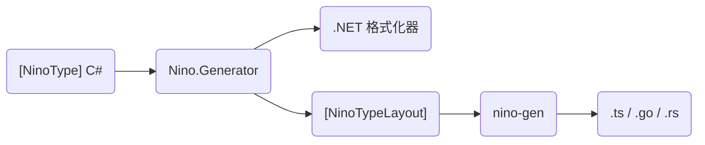

<AnchorRedirect map={{ 'example': '/zh/docs/v4/advanced/typescript#example', 'with-aspnet-core': '/zh/docs/v4/advanced/typescript#with-aspnet-core', 'api': '/zh/docs/v4/advanced/typescript#api', 'text-in-browsers': '/zh/docs/v4/advanced/typescript#text-in-browsers', 'type-mapping': '/zh/docs/v4/advanced/typescript#type-mapping', 'typed-arrays': '/zh/docs/v4/advanced/typescript#typed-arrays', 'not-supported': '/zh/docs/v4/advanced/typescript#not-supported', 'performance': '/zh/docs/v4/advanced/typescript#performance', 'compared-with-memorypack': '/zh/docs/v4/advanced/typescript#compared-with-memorypack', 'from-ninotypescript': '/zh/docs/v4/advanced/typescript#from-ninotypescript', 'typescript': '/zh/docs/v4/advanced/typescript', 'compared-with-json': '/zh/docs/v4/advanced/typescript#performance', 'go': '/zh/docs/v4/advanced/go', 'go-generated-code': '/zh/docs/v4/advanced/go#generated-code', 'struct-tags': '/zh/docs/v4/advanced/go#struct-tags', 'go-strings': '/zh/docs/v4/advanced/go#strings', 'go-values': '/zh/docs/v4/advanced/go#values', 'rust': '/zh/docs/v4/advanced/rust', 'rust-generated-code': '/zh/docs/v4/advanced/rust#generated-code', 'rust-types': '/zh/docs/v4/advanced/rust#types', 'rust-values': '/zh/docs/v4/advanced/rust#values', 'rust-derive': '/zh/docs/v4/advanced/rust#derive', 'rust-hand-written': '/zh/docs/v4/advanced/rust#hand-written', 'rust-features': '/zh/docs/v4/advanced/rust#features' }} />

你的 `[NinoType]` 在 .NET 之外也能用：**TypeScript**、**Go** 和 **Rust**。Nino 把每个 `[NinoType]` 写成对应语言的类型，配上编解码器，读写的字节和 .NET 里的 Nino 完全一致。这样浏览器、Node 服务端、Go 服务或 Rust 程序不需要 .NET 运行时，就能和你的 .NET 代码互通。本页讲各语言共通的部分（配置、选项、命令行、类型规则），各语言的具体用法见各自的页面。

## 语言 [#languages]

| 语言 | 适用场景 | 运行时 | 需要 |
| --- | --- | --- | --- |
| [TypeScript](/zh/docs/v4/advanced/typescript) | 浏览器（Web 前端的推荐用法，见[浏览器中的 .NET](/zh/docs/v4/advanced/browser#which-way)）、Node、Bun 和 Deno | `nino.ts`，写在生成的代码旁边；或者 npm 包 `nino-serialization`（[`Runtime`](#options)） | TypeScript 5.7 或更高版本，ES2022 环境：当前的浏览器，或 Node 15 及以上 |
| [Go](/zh/docs/v4/advanced/go) | 服务和工具：用生成的结构体，或者给自己的结构体加 [`nino` 标签](/zh/docs/v4/advanced/go#struct-tags) | 模块 `github.com/JasonXuDeveloper/Nino/runtimes/go/v4`（包 `nino`） | Go 1.22 或更高版本，除标准库外没有依赖 |
| [Rust](/zh/docs/v4/advanced/rust) | 服务、客户端和工具：用生成的类型，或者给自己的类型加 [derive](/zh/docs/v4/advanced/rust#derive) | crate `nino-serialization`（库名 `nino`），除非用 [`Maps="std"`](#options)，否则打开它的 `indexmap` 功能 | Rust 1.88 或更高版本 |

各语言的运行时随 Nino 每次发布，版本号与 Nino 相同（[runtimes/](https://github.com/JasonXuDeveloper/Nino/tree/main/runtimes)）。

## 生成器 [#generator]

生成器是 **nino-gen**，它有两个包，选项相同，输出也相同：

- **Nino.Codegen**，构建包：引用它的项目每次编译之后，按项目中的 `<NinoCodegen>` 项写出代码（[在构建中生成](#setup)）。
- **Nino.Codegen.Tool**，即 `nino-gen` .NET 工具，在命令行、脚本或 CI 步骤中处理构建好的程序集。它还能写出、检查[布局基线](/zh/docs/v4/evolving-data#layout-baseline)，[列出一条消息的每个字节是什么](#inspect)（[命令行用法](#command-line)）。

```xml title="Shop.Contracts.csproj"
<ItemGroup>
  <NinoCodegen Include="typescript" Out="../web/src/model" ImportExtension=".js" />
  <NinoCodegen Include="go" Out="../server/model" Package="model" Tags="json" />
  <NinoCodegen Include="rust" Out="../client/src" Name="model.rs" Serde="true" />
</ItemGroup>
```

<Callout type="info" title="环境要求">

nino-gen 在 .NET 8 或更高版本上运行（在构建中用的是 SDK 自带的运行时），与项目的目标框架无关。它读的是生成器写进布局元数据的字节编码。

</Callout>

## 工作原理 [#how-it-works]



- **基于构建出的程序集。** 生成器编译每个程序集时，都会在里面发布 `[assembly: NinoTypeLayout]` 特性（[布局元数据](/zh/docs/v4/evolving-data#layout-metadata)）。nino-gen 只读这些特性，不加载程序集，也不加载它引用的程序集：不需要源码，也不运行任何代码。它写出这个程序集里的 `[NinoType]`，以及这些类型用到的、引用程序集里的 `[NinoType]`。
- **与格式化器同一份布局。** 生成器写布局和写这个类型的 C# 格式化器，用的是同一个模型，所以生成的代码读写成员的顺序、编码和格式都和 .NET 代码一样。关于字节的每个决定只做一次，三种语言共用。
- **构建未变时不打扰。** 文件只在文本变化时才写入；只有程序集、它的引用、工具或这一项的元数据变了，这一项才会重新运行，IDE 的设计时构建从不运行它。
- **删除过时的文件。** 一次运行写出的文件记录在输出目录的 `.nino-gen` 中，下一次运行会删除其中不再写出的文件（程序集改名、换了 `Name` 或给出了 `Runtime` 之后）。目录中的其他文件不受影响。

## 在构建中生成 [#setup]

<Steps>
<Step>

### 添加包 [#add-the-package]

加到声明 `[NinoType]` 的项目里，或者引用它们的项目里（比如服务端项目）：生成的代码包含这个程序集以及它引用的程序集里的类型。

```shell
dotnet add Shop.Contracts package Nino --prerelease
dotnet add Shop.Contracts package Nino.Codegen --prerelease
```

Nino.Codegen 是开发依赖：`dotnet add package` 会把它标为 `PrivateAssets="all"`，它不会向构建输出添加任何内容，引用你项目的项目也不会继承它（它们想写出自己的类型时，自己声明项）。

```xml title="Shop.Contracts.csproj"
<PackageReference Include="Nino.Codegen" Version="..." PrivateAssets="all" />
```

</Step>
<Step>

### 声明要写出什么 [#declare-items]

每个输出一个 `<NinoCodegen>` 项。项的值是语言（`typescript` 或 `ts`、`go`、`rust`）；其余每个元数据都是一个 [nino-gen 选项](#options)。同一种语言的两个项，`Out` 不同时会各写一份。

```xml title="Shop.Contracts.csproj" tab="TypeScript" tab-group="codegen-lang"
<ItemGroup>
  <NinoCodegen Include="typescript" Out="../web/src/nino" ImportExtension=".js" />
</ItemGroup>
```

```xml title="Shop.Contracts.csproj" tab="Go" tab-group="codegen-lang"
<ItemGroup>
  <NinoCodegen Include="go" Out="../server/protocol" Package="protocol" />
</ItemGroup>
```

```xml title="Shop.Contracts.csproj" tab="Rust" tab-group="codegen-lang"
<ItemGroup>
  <NinoCodegen Include="rust" Out="../client/src" Serde="true" />
</ItemGroup>
```

引用了这个包却没有声明任何项的项目会收到警告 [NINOGEN004](#diagnostics)，什么也不写出。

</Step>
<Step>

### 构建 [#build]

```shell
dotnet build Shop.Contracts
# nino-gen: Shop.Contracts.ts, nino.ts -> .../web/src/nino
```

不给 `Out` 时，文件写到项目文件旁的 `ts/`、`go/` 或 `rust/` 中。如果另一端构建前不会先运行 `dotnet build`，就把这些文件提交到仓库。

</Step>
<Step>

### 使用 [#use-them]

每种语言的页面都展示了 nino-gen 写出的代码和调用方式：[TypeScript](/zh/docs/v4/advanced/typescript#example)、[Go](/zh/docs/v4/advanced/go#generated-code)、[Rust](/zh/docs/v4/advanced/rust#functions)。

</Step>
</Steps>

### 选项 [#options]

`<NinoCodegen>` 项的每个元数据都对应同名的 nino-gen 选项，写成 PascalCase（MSBuild 保留了元数据名 `Output`，所以写作 `Out`）：

| 元数据 | 选项 | 语言 | 默认值 | |
| --- | --- | --- | --- | --- |
| `Out` | `--out` | 全部 | 项目旁的 `ts/`、`go/` 或 `rust/` | 输出目录，相对于项目。 |
| `Name` | `--name` | 全部 | `<Assembly>.ts`、`nino_types.go`、`nino_types.rs` | 生成文件的名字。 |
| `Names` | `--names` | TypeScript | `camel` | `camel` 把成员名写成 camelCase（`UnitPrice` → `unitPrice`，`URL` → `url`）；`keep` 保留 C# 中的名字。 |
| `ImportExtension` | `--import-extension` | TypeScript | 空 | 生成的文件导入 `nino.ts` 时用的扩展名：空适用于打包工具（Vite、webpack、esbuild），`.js` 适用于用 `tsc` 编译的 Node ESM，`.ts` 适用于 Deno 和 Node 的类型剥离，也可以是 `.mjs`、`.mts`。 |
| `Runtime` | `--runtime` | TypeScript | 空 | 从这个模块导入运行时，而不是在代码旁边写出 `nino.ts`。 |
| `NumericArrays` | `--numeric-arrays` | TypeScript | `plain` | `plain`：数字的数组和列表是 `number[]`（64 位整数为 `bigint[]`）。`typed`：[类型化数组](/zh/docs/v4/advanced/typescript#typed-arrays)（`Int32Array`、`Float64Array`……）。 |
| `Package` | `--package` | Go | 程序集名中的字母和数字，转为小写 | 包名。 |
| `Tags` | `--tags` | Go | `json,yaml` | 写在 `nino` 之后的结构体标签，按顺序。不要标签：命令行写 `--tags ""`，构建里写 `Tags=","`（空的 `Tags` 等于没设，会用默认值）。 |
| `TagNames` | `--tag-names` | Go | `camel` | 这些标签里成员名的写法：`camel`、`snake` 或 `original`。 |
| `Serde` | `--serde` | Rust | `false` | `true` 加上 `#[cfg_attr(feature = "serde", derive(serde::Serialize, serde::Deserialize))]`，并为每个字段重命名。 |
| `SerdeNames` | `--serde-names` | Rust | `camel` | serde 名字：`camel`（与 `System.Text.Json` 的命名一致）、`snake` 或 `original`。 |
| `Strings` | `--strings` | Rust | `string` | `string`：C# 字符串为 `String`。`wide`：`nino::WideString`，保留未配对的代理项（[类型](/zh/docs/v4/advanced/rust#types)）。 |
| `Maps` | `--maps` | Rust | `indexmap` | `indexmap`：字典和 Set 为 `IndexMap` 和 `IndexSet`，保持读入时的顺序。`std`：`HashMap` 和 `HashSet`，除这个 crate 外没有其他依赖，写出的顺序与 .NET 不同（[安装](/zh/docs/v4/advanced/rust#install)）。 |

构建会自行传入它编译出的程序集及其引用。nino-gen 像检查命令行一样检查元数据：给了别的语言的选项，或者值不合法，构建就报 [NINOGEN001](#diagnostics) 失败。

`TagNames` 和 `SerdeNames` 根据成员的 C# 名字起名。`camel` 把开头连续的大写字母改成小写，后面紧跟小写字母时保留最后一个大写：`Health` → `health`，`ID` → `id`，`URLPath` → `urlPath`，`I128` → `i128`，`Utf8A` → `utf8A`。`snake` 用 `_` 连接各个单词并全部小写，数字跟随前一个单词：`IntList` → `int_list`，`URLPath` → `url_path`，`I128` → `i128`，`Utf8A` → `utf8_a`。`original` 保留 C# 名字。Go 字段的 `nino` 标签始终是原样的 C# 名字。

| 属性 | 默认值 | |
| --- | --- | --- |
| `NinoCodegenTargetFramework` | `TargetFrameworks` 中的第一个 | 有多个目标框架时，由哪个目标框架的构建写出文件。 |
| `NinoCodegenEnabled` | `true` | 设为 `false` 即关闭。 |

## 命令行用法 [#command-line]

`nino-gen` 工具读构建好的程序集里的布局，有三个命令：

| 命令 | 作用 | |
| --- | --- | --- |
| `nino-gen --assembly <dll> --lang ts\|go\|rust` | 写出 TypeScript、Go 或 Rust 代码，和构建时一样。 | 见下文 |
| `nino-gen layouts --assembly <dll> --out NinoLayouts.cs [--check]` | 写出程序集里类型的[布局基线](/zh/docs/v4/evolving-data#layout-baseline)；加 `--check` 时拿程序集和基线比对，有改动会让旧数据读不了（NINO034、NINO035）就以退出码 1 结束。 | [布局基线](/zh/docs/v4/evolving-data#layout-baseline) |
| `nino-gen inspect --assembly <dll> --type <name> [<file>]` | 列出一条消息的每个字节是什么。 | [查看一条消息](#inspect) |

```shell
dotnet tool install -g Nino.Codegen.Tool --prerelease
dotnet publish -c Release -o publish   # 程序集连同它的依赖，Nino.Core.dll 也在其中
nino-gen --assembly publish/Shop.Contracts.dll --lang go --out ../server/protocol
nino-gen layouts --assembly publish/Shop.Contracts.dll --out Shop.Contracts/NinoLayouts.cs --check
```

每个命令都接受 `--references`（见下表），加 `--help` 会打印用法。本节下面讲的是生成代码：

```text
nino-gen --assembly <dll> --lang ts|go|rust --out <dir> [--references <file>] [--name <file name>]
  ts:   [--names camel|keep] [--import-extension <.js|.ts|.mjs|.mts>] [--runtime <module>] [--numeric-arrays plain|typed]
  go:   [--package <name>] [--tags json,yaml] [--tag-names camel|snake|original]
  rust: [--serde] [--serde-names camel|snake|original] [--strings string|wide] [--maps indexmap|std]
```

选项就是[上表](#options)中的那些，另外还有：

| 选项 | |
| --- | --- |
| `--assembly` | 构建好的程序集。 |
| `--lang` | `ts`（或 `typescript`）、`go` 或 `rust`。 |
| `--references` | 一个文件，每行一个程序集路径，用于解析引用；`.dll` 所在的目录和当前运行的 .NET 无论如何都会搜索。类库的 `bin/` 中没有它所用包的副本（包括 `Nino.Core.dll`）：把它们列在这里。使用 Nino.Codegen 的构建会把这个文件写到 `obj/<configuration>/<framework>/nino-gen/references`。 |

未知的选项、重复给出的选项、属于其他语言的选项或取值不对的选项都是错误，缺少参数也是。`--serde` 后面可以跟 `true` 或 `false`。

### 诊断 [#diagnostics]

nino-gen 按 MSBuild 的消息格式报告，所以构建会把它们显示为项目的警告和错误：

| ID | 严重级别 | |
| --- | --- | --- |
| `NINOGEN001` | 错误 | 参数或项的元数据无效，或无法读取程序集。工具以退出码 1 结束，构建失败。 |
| `NINOGEN002` | 警告 | 某个类型目标语言无法表达，所以跳过，并说明原因（见[不会生成的内容](#not-generated)）。 |
| `NINOGEN003` | 警告 | 项目设置了 Nino.TypeScript 的 `NinoTypeScript*` 属性（见[从 Nino.TypeScript 迁移](/zh/docs/v4/advanced/typescript#from-ninotypescript)）。 |
| `NINOGEN004` | 警告 | 项目引用了 Nino.Codegen，却没有声明 `<NinoCodegen>` 项，所以什么也不写出：添加一项，或把 `NinoCodegenEnabled` 设为 `false`。 |

```text
nino-gen : warning NINOGEN002: Samples.Nest`1 is not written to Go: it holds itself with other type arguments, through Samples.Nest`1.
```

## 查看一条消息 [#inspect]

`nino-gen inspect` 按程序集发布的布局读一条消息，把每个字节是什么列出来：每个成员的偏移、长度、编码和值，类型 ID 对应的类型，键控条目的键（不认识的键显示为跳过的字节），旧数据里缺少的成员，引用头和推迟的主体。别的语言发来的数据、抓包、日志或存档读不出来，或者读出来的值不对时，用它来排查。

```shell
nino-gen inspect --assembly publish/Shop.Contracts.dll --type Shop.Contracts.Order order.bin
xxd -p frame.bin | nino-gen inspect --assembly publish/Shop.Contracts.dll --type Shop.Contracts.Order --hex --offset 4
```

| 选项 | |
| --- | --- |
| `--assembly`、`--references` | 和生成代码时一样。必须给出程序集：按位置格式的数据里没有成员名、长度和类型，离开布局就读不了。 |
| `--type` | 消息写出时的类型，用运行时形式的名字：`Namespace.Outer+Inner`、`Namespace.Box<System.Int32>`、`System.Collections.Generic.List<Namespace.Point>`。 |
| `<file>` | 消息文件；省略或写 `-` 时从标准输入读。 |
| `--hex` | 输入是十六进制文本；字节之间的空白、`,`、`:`、`-` 和 `0x` 都忽略。 |
| `--offset` | 从这个字节开始读，用于大缓冲区里的一帧（比如跳过你自己的长度前缀）。输出里的偏移按整个输入算。 |
| `--json` | 把结果树写成 JSON 给工具用：每个节点有 `name`、`type`、`encoding`、`offset`、`length` 和 `value`，顶层还有 `error` 和 `trailing`。 |

用当前类型读一条旧版本写出的键控消息：

```text
       0      61  value: Conformance.KeyedV2  (keyed)
       0       1    presence = 1
       1       4    length = 56
       5      12    Hp: int [raw(4)] = 42  (key 0x99A16761 (a former name))
      17      12    Name: string [string] = "old"  (key 0x3085B3E2; Latin-1, 3 char(s))
      29      16    (unknown key)  (key 0xDCA8A053: 8 byte(s) skipped)
      45      16    Score: long [raw(8)] = 1152921504606846976  (key 0x044AB14D)
      61       0    Level  (no entry (key 0xEAA8149B): default value)
```

- 它做的检查和读取[不可信数据](/zh/docs/v4/security#untrusted-mode)时完全一样，恶意字节不会让它崩溃或卡住。数据有问题时，它先输出已经读到的部分，再给出出错的偏移和没通过的检查（`nino-gen: malformed data at offset 1: type id 0xAD792380 is Conformance.Cat, not a Conformance.Dog`），以退出码 2 结束；命令行写错时退出码是 1。
- 值后面多出来的字节只报告偏移，不往下读，方便你看出下一帧从哪里开始。
- 需要写出这条消息时用的程序集，或者布局还能读它的更新版本：用改过类型的新构建来读，输出就是新构建会读到的内容，正好用来检查它还能不能读旧数据。
- 由[自定义格式化器](/zh/docs/v4/custom-formatters)写出的成员，在键控条目里或作为版本容错类型的最后一个成员时，会原样显示它的字节；在其他位置，没有任何信息说明它的字节到哪里结束，读到这里就会停下。

## 各语言中的类型 [#types]

每个 `[NinoType]` 生成一个类型，每个成员用这门语言里对应 .NET 所写内容的类型。差别最大的几类：

| C# | TypeScript | Go | Rust |
| --- | --- | --- | --- |
| 结构体 | 类 | `X` | `X` |
| 密封类 | `X \| null` | `*X` | `Option<X>` |
| 非密封类、抽象类、接口 | `X \| null`，可以是任何生成的子类型 | 接口，由每个允许的类型实现 | `Option<XRef>`，由允许的类型组成的枚举 |
| `object` | `unknown` | `nino.Typed` | `Option<AnyObject>` |
| 枚举 | `as const` 对象和它的值的类型 | 带常量的具名整数类型 | 整数，外加一个列出具名值的单元结构体 |
| `string` | `string \| null` | `*string` | `Option<String>` |
| `T[]`、`List<T>` | `T[] \| null` | `[]T` | `Option<Vec<T>>` |
| `HashSet<string>` | `Set<string \| null> \| null` | `[]*string` | `Option<IndexSet<Option<String>>>` |
| `Dictionary<K, V>` | `Map<K, V> \| null` | `[]nino.Entry[K, V]` | `Option<IndexMap<K, V>>` |
| `decimal`、`Guid`、`DateTime` | `string`、`string`、`Date` | `nino.Decimal`、`nino.Guid`、`nino.DateTime` | `nino::Decimal`、`nino::Guid`、`nino::DateTime` |

Set 中的字符串在每种语言里都可以是 null，与 .NET 一致（`HashSet<string>` 可以包含一个 null）；字典的键则不会是 null，因为 .NET 遇到 null 键会抛出异常。

完整的类型表，以及怎样构造 .NET 的值：[TypeScript](/zh/docs/v4/advanced/typescript#type-mapping)、[Go](/zh/docs/v4/advanced/go#values)、[Rust](/zh/docs/v4/advanced/rust#types)。

## 原始结构体的字段 [#raw-struct-fields]

原始结构体（按一整块写出的非托管结构体，见[原始值](/zh/docs/v4/wire-format#raw-values)）生成的类型由它的字段组成，每个字段放在规范布局里的偏移处，填充字节为 0。在 .NET 里大小或布局随主机变化的字段（`nint`、`nuint`、指针、`Int128`、`DateTimeOffset`、原始类型 `T` 的 `T?`）按二进制格式规定的固定字节写出，在每种语言里也有固定的类型：[TypeScript](/zh/docs/v4/advanced/typescript#type-mapping)、[Go](/zh/docs/v4/advanced/go#values)、[Rust](/zh/docs/v4/advanced/rust#types)。TypeScript 表达不了 `DateTimeOffset` 字段，含它的结构体会跳过（[TypeScript 不支持的内容](/zh/docs/v4/advanced/typescript#not-supported)）。`Int128?` 数组的步长是 32 字节（存在字节、15 个 0、值）。`Vector64<T>` 到 `Vector512<T>` 字段在每种语言里都报 NINOGEN002；旧版本构建的布局里如果有 `System.Numerics.Vector<T>`，也一样：`Vector<T>` [不能序列化](/zh/docs/v4/struct-layouts#vector-t)。

## 泛型类型 [#generics]

泛型 `[NinoType]` 在每种语言里都生成泛型类型，它的编解码器由类型实参的编解码器组合而成，就像 .NET 用 `Box<T>` 和 `int` 的格式化器拼出 `Box<int>` 的格式化器：

```csharp title="Box.cs"
using Nino.Core;

[NinoType]
public sealed class Box<T>
{
    public T Value;
}
```

`Box<T>`、它的编解码器和作为成员的 `Box<int>` 在各语言中的样子：[TypeScript](/zh/docs/v4/advanced/typescript#generics)、[Go](/zh/docs/v4/advanced/go#generics)、[Rust](/zh/docs/v4/advanced/rust#generics)。

封闭的用法（`Box<int>`、`Pair<int, string>`、`Box<Box<int>>`、`List<Box<int>>`）写成带类型参数的泛型类型。在泛型类型内部，它的类型参数可以出现在任何成员类型能出现的位置：`T`、`List<T>`、`Dictionary<string, T>`、`T[]`、`T : struct` 时的 `T?`、元组、`Box<T>`、`Pair<int, T>`，以及以 `Node<T>` 形式出现的类型自身。类型实参可以是基元类型、枚举、字符串、`[NinoType]`（包括泛型的）、数组、`List<T>`、`HashSet<T>`、`Dictionary<TKey, TValue>`、`ValueTuple`、`Nullable<T>` 或 `KeyValuePair<TKey, TValue>`，在集合中也可以（`Wrap<int?[]>`、`Wrap<List<int?>>`、`Wrap<Dictionary<int, double?>>`），编码都和 .NET 对应的格式化器写出的一样。

封闭的泛型 `[NinoType]` 结构体（`Pair<byte, int>`）无论出现在哪里（成员、元素或类型实参），都是带类型参数的泛型类型，并像 .NET 那样逐成员读写：类型参数类型的字段，不论实参是什么，都不会按原始内存复制。

泛型类型如果用别的类型实参包含自己（`Nest<T>` 里有 `Nest<List<T>>`），不管是直接包含还是经过另一个泛型类型，数据每深一层就需要一个新的实例化。TypeScript 能生成它：编解码器第一次读写下一层时，才构建下一层的编解码器，所以构建出的编解码器不会比数据的层数多。Go 和 Rust 在编译期实例化泛型，表达不了它：它们跳过它和包含它的类型，并给出警告 NINOGEN002（“it holds itself with other type arguments”）。

### 按类型 ID 写出的泛型类型 [#generic-types-behind-a-type-id]

非密封的泛型类、抽象泛型类或泛型接口，写出时带的是封闭后的 .NET 名称（`Shop.Shelf<System.Int32>`）的类型 ID。每个封闭类型都是一个单独的槽位，槽位的各个分支是可以赋值给它的具体类型：封闭泛型类型（`ListShelf<int>`）和非泛型子类型（`IntShelf : Shelf<int>`）。即使没有代码提到，nino-gen 也会加入槽位需要的封闭类型（持有 `Open<T>` 的 `OpenHolder<long>` 需要 `Open<long>` 及其子类型）；泛型类型里如果有一个由自己的类型参数构成的槽位，这个槽位按每个封闭用法分别取得（具体写法见 [TypeScript](/zh/docs/v4/advanced/typescript#generics)、[Go](/zh/docs/v4/advanced/go#generics)、[Rust](/zh/docs/v4/advanced/rust#generics)）。

值的类型 ID 不在槽位允许的范围内（其他封闭类型、未知 ID）时，直接拒绝。

### 槽位中的封闭泛型类型 [#closed-generic-types-in-slots]

泛型子类型（`sealed class Box<T> : Animal`，或实现了 `[NinoType]` 接口的泛型结构体）在多态槽位或 `object` 槽位里，写出的是封闭后的 .NET 名称（`Shop.Box<System.Int32>`）的哈希。布局里只有定义（`Box<T>`），所以 nino-gen 从程序集的元数据里读封闭类型：签名、`new Box<int>()`、`typeof(Box<int>)` 或泛型方法的类型实参（`NinoPolymorphic.TryRegister<Box<int>>()`）提到的每个封闭类型都算。其中定义是具体泛型 `[NinoType]` 的，就是它能赋值到的每个槽位的一个分支（`object` 槽位全都接受），用它的类型实参的编解码器读写。

<Callout type="warn" title="和 .NET 接受的范围不完全一样">

程序集里没有任何代码提到的封闭类型读不了：每个目标语言都不认识它的类型 ID，就像从没注册、也没写过它的 .NET 进程一样。反过来，目标语言接受程序集提到的每个封闭类型，而新启动的 .NET 进程只接受已经[注册](/zh/docs/v4/defining-types#generic-types)或写过的类型：.NET 因为还没见过某个类型 ID 而拒绝的数据，TypeScript、Go 和 Rust 却能读。调用了那些 `NinoPolymorphic.TryRegister<...>()` 之后，.NET 接受的范围就和它们一样了。

</Callout>

## 引用追踪 [#reference-tracking]

声明了 [`[NinoType(trackReferences: true)]`](/zh/docs/v4/reference-tracking) 的类型，每种语言都会生成，引用头和 .NET 写的一样：0 表示 null，-1 表示之前没写过的对象（后面跟着它的主体），其他值是之前写过的对象的编号。对象一创建、还没读主体时就记下来，所以主体里可以持有它所在的对象（循环）。开了引用追踪的类型，不管是没有子类型的类、按类型 ID 写出的类或接口，还是放在不追踪的槽位（`object`、没开追踪的基类）里，读写方式都和 .NET 一样。

追踪引用的类 `Node` 在 [TypeScript](/zh/docs/v4/advanced/typescript#reference-tracking) 中是 `Node | null`，在 [Go](/zh/docs/v4/advanced/go#reference-tracking) 中是 `*Node`，在 [Rust](/zh/docs/v4/advanced/rust#reference-tracking) 中是 `Option<nino::Shared<Node>>`，对它的每个引用都是同一个对象。

引用头不是 -1、0 或已读对象的编号时直接拒绝；回引用指向的对象类型不在槽位允许的范围内，同样拒绝；每个新对象至少占 4 个字节的引用头，所以对象表的增长不会快于数据。

## `[NinoType]` 集合 [#ninotype-collections]

派生自集合的 `[NinoType]` 类（带有自己成员的 `class Bag : List<int>`）先按集合本身的方式写出元素，再写出成员。每种语言都给这个类型加一个元素字段，放在成员之前：TypeScript 中是 `$elements`（数组、`Map` 或 `Set`），Go 中是 `Elements`（标签 `nino:"-"`，JSON 中为 `$elements`），Rust 中是 `elements`（serde 中为 `$elements`）。元素永远不是 null，因为集合就是这个对象本身：数据里把它们标成 null 的，一律拒绝，和 .NET 一样。

## 不可信数据 [#untrusted-data]

TypeScript、Go 和 Rust 的读取器与 .NET 读取器一样，按不可信输入处理数据（[不可信数据](/zh/docs/v4/security)）：数据如果不是所读类型的有效值，就以这个运行时唯一的错误类型报错，不会抛出其他异常或 panic，也不会越界读取、无限制地递归，或者分配比数据本身还多的内存。

- **边界与内存。** 每次读取都检查边界；长度或数量在分配任何内存之前，先与剩余字节数比较。
- **深度。** 嵌套超过 128 层的类主体完全按 .NET 的方式推迟，所以字节一致，栈深度也有上限；不能推迟的（以及包含自身的结构体）超过 512 层就失败。
- **多态。** 按类型 ID 写出的槽位只接受这个槽位允许的类型的 ID；从不按名字查找类型。
- **.NET 在任何模式下都拒绝的内容。** 不是 0 或 1 的 `bool` 和存在字节、超出其区域末尾的成员、值没有填满条目的键控成员、格式错误的推迟主体段、字典或 Set 里重复的键或元素。
- **值之后的字节**不读取，与 .NET 的默认行为一致（TypeScript 的 `deserializeExact`、Go 的 `DeserializeExact` 和 Rust 的 `deserialize_exact` 会拒绝它们）。

每个运行时各自补充的内容（它的错误类型、对哈希洪泛的防护、比 .NET 更严格的检查）：[TypeScript](/zh/docs/v4/advanced/typescript#untrusted-data)、[Go](/zh/docs/v4/advanced/go#untrusted-data)、[Rust](/zh/docs/v4/advanced/rust#untrusted-data)。

## 不会生成的内容 [#not-generated]

nino-gen 会跳过目标语言无法表达的类型以及包含它们的类型，并给出警告 NINOGEN002。每种语言都跳过：

- 槽位中，程序集和槽位都没有提到的封闭泛型类型：它们的 ID 是未知的（[槽位中的封闭泛型类型](#closed-generic-types-in-slots)）；
- 带 `trackReferences` 的泛型类型；
- 由 Nino.Core 以外的格式化器写出的成员：[自定义格式化器](/zh/docs/v4/custom-formatters)、`Nino.Immutable` 的不可变集合，以及 Unity 的 `AnimationCurve`、`Gradient` 和 `RectOffset`，布局里没有描述它们的字节；
- 原始结构体的 `Vector64<T>` 到 `Vector512<T>` 字段（[原始结构体的字段](#raw-struct-fields)），以及旧版本构建的、含 `System.Numerics.Vector<T>` 的布局。

[序列化回调](/zh/docs/v4/defining-types#callbacks)（`[NinoOnSerializing]` 等四个特性）不改变任何字节，有没有它们，生成的代码都一样，而且生成的代码不会调用这类方法：回调在 .NET 里做的事（检查值、填缓存），在 TypeScript、Go 或 Rust 里由调用编解码器的代码来做。

各语言另外跳过的内容：[TypeScript](/zh/docs/v4/advanced/typescript#not-supported)、[Go](/zh/docs/v4/advanced/go#not-supported)、[Rust](/zh/docs/v4/advanced/rust#not-supported)。

## 如何测试 [#tests]

nino-gen 为一致性语料中的类型生成的 TypeScript、Go 和 Rust 代码提交在 Nino 的仓库中，并在各语言中用语料运行：每个有效用例都要读出并逐字节写回，每个恶意用例和截断的前缀都必须拒绝。Nino 的集成测试还用 Nino.Codegen 的构建目标为每种语言构建项目，把输出与 nino-gen 的输出比较，在 Node 中用 .NET 写出的字节运行生成的 TypeScript（也让 .NET 读取 TypeScript 创建的值），并用 `tsc --strict --noUnusedLocals --noUnusedParameters` 编译它。设计说明见 [docs/codegen.md](https://github.com/JasonXuDeveloper/Nino/blob/main/docs/codegen.md)。

## 下一步 [#next-steps]

<Cards>
  <Card title="TypeScript" href="/zh/docs/v4/advanced/typescript">用于浏览器和 Node 的类和编解码器：API、类型化数组和浏览器中的文本。</Card>
  <Card title="Go" href="/zh/docs/v4/advanced/go">生成的结构体和编解码器，或者带 nino 标签的自定义结构体。</Card>
  <Card title="Rust" href="/zh/docs/v4/advanced/rust">生成的类型和编解码器、derive 和手写 impl。</Card>
  <Card title="数据演进" href="/zh/docs/v4/evolving-data">已部署的客户端在更新前一直运行旧代码：选择能容忍变化的格式。</Card>
</Cards>
