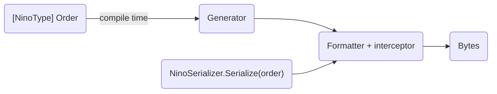

import { ArrowRightLeft, Swords } from 'lucide-react';

## What Is Nino?

Nino is a general-purpose, high-performance binary serializer for C# and .NET. Use it wherever .NET code turns objects into bytes and back: service messages and RPC, message queues, caches, files and local stores, inter-process communication, data pipelines and telemetry. It runs on .NET servers and desktop apps, NativeAOT, Unity (including HybridCLR) and Godot, and code that [Nino.Codegen](/en/docs/v4/advanced/codegen) generates from the same types reads and writes the same bytes in TypeScript, Go and Rust.

Mark a type with `[NinoType]` and a Roslyn source generator writes its serialization code at compile time; at run time you call `NinoSerializer.Serialize` and `NinoDeserializer.Deserialize`. No reflection reads or writes your members, and there is no runtime code generation, no schema file and no registration step.

```csharp
using Nino.Core;

[NinoType]
public class Order
{
    public long Id;
    public string Customer;
    public List<OrderLine> Lines;
}

byte[] bytes = NinoSerializer.Serialize(order);
Order copy = NinoDeserializer.Deserialize<Order>(bytes);
```



## Start Here

The docs follow three tracks, in the sidebar's order. New to Nino? Take the first one from the top: its first three pages get a type serialized in about ten minutes, and by its end you know what to settle before your data ships.

| <span style={{ whiteSpace: 'nowrap' }}>Track</span> | Read, in order | You can then |
| --- | --- | --- |
| <span style={{ whiteSpace: 'nowrap' }}>**Basics**</span> | [Quick Start](/en/docs/v4/start) → [Serialize and Deserialize](/en/docs/v4/basic) → [Defining Types](/en/docs/v4/defining-types) → [Supported Types](/en/docs/v4/types) → [Custom Constructors](/en/docs/v4/constructors) → [Polymorphism](/en/docs/v4/polymorphism) → [Evolving Your Data](/en/docs/v4/evolving-data) → [Untrusted Data](/en/docs/v4/security) → [Best Practices](/en/docs/v4/best-practices) | Ship a first version: types defined, each type's format chosen, untrusted input handled. |
| <span style={{ whiteSpace: 'nowrap' }}>**Performance**</span> | [High-Performance Serialization](/en/docs/v4/advanced/high-performance) → [Designing Types for Speed](/en/docs/v4/advanced/type-design) → [Reuse and Pooling](/en/docs/v4/pooling) → [Zero-Allocation Patterns](/en/docs/v4/advanced/zero-allocation) → [Build Configuration](/en/docs/v4/advanced/build-configuration) | Serialize and deserialize at 0 B per call, with the build settings that give the fastest machine code. |
| <span style={{ whiteSpace: 'nowrap' }}>**Advanced**</span> | [Reference Tracking](/en/docs/v4/reference-tracking) → [Custom Formatters](/en/docs/v4/custom-formatters) → [Streams and Compression](/en/docs/v4/advanced/streams) → [Guides](/en/docs/v4/advanced) → [Wire Format](/en/docs/v4/wire-format) | Keep shared references and cycles, serialize any type, and connect Nino to streams, services, engines and other languages. |

Evaluating Nino, or coming from v3? Start with one of these instead:

<Cards>
  <Card icon={<Swords />} title="Nino vs MemoryPack" href="/en/docs/v4/vs-memorypack">
    Where Nino is ahead, where MemoryPack still is, with the numbers.
  </Card>
  <Card icon={<ArrowRightLeft />} title="Migrating from v3" href="/en/docs/v4/migration">
    API and attribute changes, and what to do with v3 data.
  </Card>
</Cards>

## Why Nino

- **Fast.** <IfWorkloads>On [real-world workloads](/en/docs/v4/benchmarks#workloads) in the same run, Nino serializes up to <BenchValue k="workloads.memorypack.serialize.max" /> faster than MemoryPack and deserializes up to <BenchValue k="workloads.memorypack.deserialize.max" /> faster. It serializes up to <BenchValue k="workloads.messagepack.serialize.max" /> faster than MessagePack, <BenchValue k="workloads.protobuf.serialize.max" /> than protobuf-net, <BenchValue k="workloads.googleprotobuf.serialize.max" /> than Google.Protobuf and <BenchValue k="workloads.json.serialize.max" /> than System.Text.Json.</IfWorkloads><IfWorkloads not>Against MemoryPack in the same run, Nino serializes up to <BenchValue k="serialize.max" /> faster and deserializes classes and polymorphic graphs up to <BenchValue k="deserialize.max" /> faster; on arrays of unmanaged structs, which both copy as one block, the two are at least on par. It serializes up to <BenchValue k="messagepack.serialize.max" /> faster than MessagePack and <BenchValue k="protobuf.serialize.max" /> faster than protobuf-net.</IfWorkloads> See [Benchmarks: .NET Runtime](/en/docs/v4/benchmarks).
- **Safe for untrusted data.** Data from a network peer or a user's file cannot crash the process, allocate out of proportion to its size or make Nino create a type you did not declare: every invalid input throws one `NinoDataException`. See [Untrusted Data](/en/docs/v4/security).
- **Zero GC on hot paths.** Serializing [into a reused buffer](/en/docs/v4/basic#reusing-a-buffer) allocates nothing. Deserializing [into existing objects and pooled instances](/en/docs/v4/pooling) allocates nothing either: a string whose text is unchanged is kept, and only changed text is read into a new string.
- **Everything at compile time.** The generator writes one formatter per type, so Nino works on IL2CPP, NativeAOT and HybridCLR. On the .NET 8 SDK and later, [interceptors](/en/docs/v4/performance#interceptors) route each call straight to the right formatter. The generator is incremental: editing a type regenerates that type only, and the generated code compiles far faster than v3's ([build times](/en/docs/v4/whats-new#faster-to-build)).
- **Polymorphism without tags.** Values declared as a base class or interface are read back as their runtime type. Type ids are hashes of type names, so there is no tag table to maintain, and Nino finds subtypes in other assemblies on its own. See [Polymorphism](/en/docs/v4/polymorphism).
- **Data that evolves.** Per type, choose [version tolerance](/en/docs/v4/evolving-data#version-tolerance) (append members), [keyed members](/en/docs/v4/evolving-data#keyed-members) (add, remove and reorder members) or [reference tracking](/en/docs/v4/reference-tracking) (shared references and cycles). Types that don't opt in pay nothing. A [layout baseline](/en/docs/v4/evolving-data#layout-baseline) in your project flags, as you type, a change that would break data already written.
- **The same bytes everywhere.** Every build, from .NET Standard 2.0 to .NET 10's, writes identical bytes on CoreCLR, Mono and IL2CPP, 64-bit and 32-bit, x64 and Arm64, so a Unity client and a .NET server can read each other's data; the Go, Rust and TypeScript runtimes read and write the same bytes too. See [Platforms](/en/docs/v4/platforms).
- **Thread safe.** Every `NinoSerializer` and `NinoDeserializer` method can be called from any number of threads, with no locks on the hot path.
- **Mistakes caught while you type.** 44 [analyzer diagnostics](/en/docs/v4/analyzers) (NINO001–NINO044), many with a one-click code fix.

## Where It Fits

| Use case | What Nino gives you |
| --- | --- |
| [Networking and RPC](/en/docs/v4/advanced/networking) | Serialize into a `PipeWriter` or any `IBufferWriter<byte>`, read from a `ReadOnlySpan<byte>`, reuse pooled messages; polymorphic messages without opcode tables. |
| [ASP.NET Core](/en/docs/v4/advanced/aspnetcore) | `application/x-nino` request and response bodies in MVC and Minimal APIs, read and written straight from the request and response pipes (Nino.AspNetCore). |
| [Use in Other Languages](/en/docs/v4/advanced/codegen) | Types and codecs for browsers, Node, Go and Rust, generated from your types after each build (Nino.Codegen), reading and writing the same bytes as .NET. |
| [Message queues and event streams](/en/docs/v4/advanced/message-queues) | Compact payloads, event hierarchies read back as their real type, batches of unmanaged records copied as one block. |
| [Files and streams](/en/docs/v4/advanced/streams) | Serialize to and read from any `Stream`, synchronously or with `async`, and compress with the stream classes of .NET. |
| [Caching](/en/docs/v4/advanced/caching) | Small values for Redis or `IDistributedCache`, no allocations of its own per call, types that stay readable across deployments. |
| [Persistence](/en/docs/v4/advanced/persistence) | Files, key-value stores and logs: keyed and version-tolerant types survive updates, reference tracking keeps object graphs intact. |
| [IPC and hot paths](/en/docs/v4/advanced/zero-allocation) | Framed streams and fixed-size records at 0 B per call, from any thread. |
| [Unity and HybridCLR](/en/docs/v4/advanced/unity) | Unity 2022.3+ from OpenUPM, generator included; `Vector3` and other unmanaged structs copied as raw memory; no init call for hot-update assemblies. |
| [Godot 4 (.NET)](/en/docs/v4/advanced/godot) | A regular NuGet package; Godot's math structs are copied as raw memory. |

## What Nino Serializes

- **Your types**: classes, structs, records, interfaces and generic types marked `[NinoType]`, including [private members](/en/docs/v4/defining-types#private-members), [custom constructors](/en/docs/v4/constructors), [callbacks](/en/docs/v4/defining-types#callbacks) before and after each value, and [renamed types](/en/docs/v4/evolving-data#former-name). See [Defining Types](/en/docs/v4/defining-types).
- **Built-in types**: primitives, enums, strings, `Nullable<T>`, tuples, arrays, the BCL collections, BCL types such as `BigInteger`, `Uri` and `Memory<T>`, your own collection types and, with `Nino.Immutable`, every immutable collection; in Unity also `AnimationCurve`, `Gradient` and `RectOffset`. See [Supported Types](/en/docs/v4/types).
- **Anything else** through a [custom formatter](/en/docs/v4/custom-formatters), for one member or a whole type.

## When Not to Use It

- **You need a human-readable format.** Nino writes binary. Use JSON, YAML or TOML for files that people read or edit.
- **A program in another language (Java, Python, C++...) reads the data.** The format is defined by your C# types; there is no schema file and no code generator for those languages, so use Protocol Buffers, FlatBuffers or MessagePack (see [Which to Choose](/en/docs/v4/compare#which-to-choose)). TypeScript, JavaScript, Go and Rust are the exception: [Nino.Codegen](/en/docs/v4/advanced/codegen) generates their codecs from your types.
- **You must read Nino v3 data directly.** v4 has a new binary format, so old data has to be converted once. See [Migrating from v3](/en/docs/v4/migration#converting-v3-data).

## Older Versions

The documentation of Nino [v3](/en/docs/v3) and [v2](/en/docs/v2) is still available. Their binary formats are not compatible with v4. See [Format Versions](/en/docs/v4/versioning).
