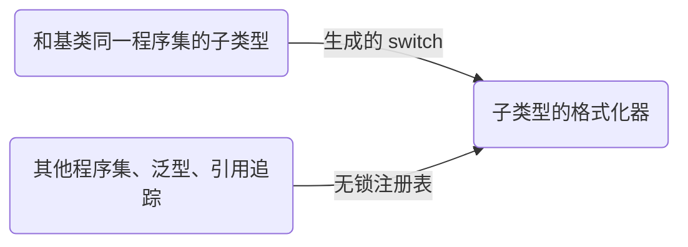

<AnchorRedirect
  map={{
    'ref-deserialization': '/zh/docs/v4/polymorphism#reuse-deserialization',
  }}
/>

Nino 会把值的运行时类型一起写出，所以声明为基类或接口的值，读回来仍是它实际的类型。事件溯源里一个订单的事件历史、一张图纸里的各种图形、网络协议里的各种消息，都要靠这一点：声明的是一个类型，实际装的是多种具体类型。

```csharp title="OrderEvents.cs"
using System;
using Nino.Core;

[NinoType] // [!code highlight]
public abstract class OrderEvent
{
    public long OrderId;
    public DateTime At;
}

public sealed class OrderPlaced : OrderEvent   // 继承 [NinoType]
{
    public decimal Total;
}

public sealed class OrderShipped : OrderEvent
{
    public string Carrier;
}

public sealed class OrderCancelled : OrderEvent { }
```

```csharp
var history = new List<OrderEvent>
{
    new OrderPlaced { OrderId = 7, Total = 40m },
    new OrderCancelled { OrderId = 7 },
};
byte[] bytes = NinoSerializer.Serialize(history);
List<OrderEvent> events = NinoDeserializer.Deserialize<List<OrderEvent>>(bytes);
// events[0] 是 OrderPlaced，events[1] 是 OrderCancelled
```

<Callout type="info">

在 v4 中，子类型从最近的 `[NinoType]` 基类或接口**继承** `[NinoType]`（连同选项），除非基类设了 `inheritedBySubtypes: false`。想给子类型单独设选项，在子类型上再加 `[NinoType]` 就行。

</Callout>

## 接口与抽象类 [#interfaces-and-abstract-classes]

接口和抽象类用法一样：给接口或抽象类加上 `[NinoType]`，实现它的类和结构体自动继承这个特性：

```csharp tab="接口示例"
[NinoType] // [!code highlight]
public interface IBase
{
    int A { get; set; }
}

public class Impl : IBase
{
    public int A { get; set; }
}

public struct ImplStruct : IBase
{
    public int A { get; set; }
}
```

```csharp tab="抽象类示例"
[NinoType] // [!code highlight]
public abstract class Base
{
    public int A { get; set; }
}

public class Derived : Base
{
    public int B { get; set; }
}
```

`[NinoType]` 接口的成员由各个实现类型写出，分两种情况：

| 实现类型有 | 写出什么 | 用谁的特性 |
| --- | --- | --- |
| 同名的成员（`public int A { get; set; }`） | 这个成员 | 实现成员的。接口成员上只有 `[NinoMember(index)]` 算数，它决定成员的位置；标在那里的 `[NinoUtf8]`、`[NinoMemberFormatter]` 或 `[NinoIgnore]` 会报警告 [NINO033](/zh/docs/v4/analyzers#nino033)，代码修复会把它移到实现成员上 |
| 显式实现（`int IBase.A { get; set; }`）或接口的默认实现 | 接口的这个成员，通过接口访问（结构体不装箱） | 接口成员的 |

通过声明为接口或 `object` 的成员读结构体时，结构体会装箱。

泛型接口和泛型抽象类（`IRepository<T>`、`abstract class Box<T>`），以及嵌套在泛型类型里的抽象类，用法也一样：`Serialize<Box<int>>(new IntBox())` 写出的是子类型，读取时检查数据里的类型确实是 `Box<int>` 的子类型。类型实参可以是任何类型：基元类型、元组（`Box<(int, string)>`）、密封类，或者本身有子类型的类。每个封闭基类型（`Box<int>`、`Box<Order>`）都和非泛型基类型一样，对同一程序集里声明的子类型使用生成的分派（见[分派](#dispatch)）。

## 多态值怎么写 [#how-a-polymorphic-value-is-written]

头部（值前面的存在字节或类型 ID）由槽位的**声明**类型决定（槽位指成员、集合元素，或者你调用 `Serialize<T>`/`Deserialize<T>` 时的类型参数）：

| 声明类型 | 头部 | 是否多态 |
| --- | --- | :---: |
| `struct` | 无 | 否 |
| `sealed class` | 存在字节（1 字节，`0` = null） | 否 |
| 非密封类、抽象类、接口 | 4 字节类型 ID（`0` 表示 null） | 是 |
| `object` | 4 字节类型 ID | 是，可以是任意 `[NinoType]` |

同一个 `Circle { Id = 1, R = 1f }` 在不同声明类型下写出的字节（取自[规范](https://github.com/JasonXuDeveloper/Nino/blob/main/docs/spec/wire-format.md#a2-polymorphism)的例子，命名空间 `Spec`）：

<Bytes rows={[
  { title: <>声明为 <code>Circle</code>（密封）</>, fields: [{ hex: '01', kind: 'header', label: '存在字节' }, { hex: '01 00 00 00 00 00 80 3F', kind: 'value', label: 'Id = 1，R = 1f' }] },
  { title: <>声明为 <code>Shape</code>（抽象）</>, fields: [{ hex: 'AC 2B C0 ED', kind: 'id', label: 'Spec.Circle 的类型 ID' }, { hex: '01 00 00 00 00 00 80 3F', kind: 'value', label: 'Id = 1，R = 1f' }] },
  { title: <>null，声明为 <code>Circle</code></>, fields: [{ hex: '00', kind: 'header', label: '存在字节 0' }] },
  { title: <>null，声明为 <code>Shape</code></>, fields: [{ hex: '00 00 00 00', kind: 'id', label: '类型 ID 0' }] },
]} />

类型 ID 是运行时类型全名的 FNV-1a 哈希，由生成器算出，所以不用手动分配标签，也不用在多个程序集之间保持同步。类型改名或换命名空间时，请用 [`[NinoFormerName]`](/zh/docs/v4/evolving-data#former-name)。

<Callout type="idea">

没有子类型的类请声明为 `sealed`。密封类只占 1 字节，也不用分派；非密封类哪怕一个子类型都没有，也要占 4 字节，还要做一次类型检查。

</Callout>

### 查看类型 ID [#inspecting-type-ids]

`NinoTypeId` 在运行时算出同样的 ID，可以用来打日志、校验协议，或者在握手时比对双方的消息集合：

```csharp
int id = NinoTypeId.Of(typeof(OrderShipped));                   // 写出 OrderShipped 时用的 ID（会考虑 [NinoFormerName]）
string name = NinoTypeId.GetRuntimeName(typeof(OrderShipped));  // 它的运行时形式名称，例如 "MyApp.Events.OrderShipped"
string hashed = NinoTypeId.GetHashedName(typeof(OrderShipped)); // 计算 ID 所用的名称：有 [NinoFormerName] 时就是它
int same = NinoTypeId.Compute(hashed);                          // == id：运行时形式名称的哈希
```

ID 永远不会是 `0`，`0` 用来表示 null。

## 分派 [#dispatch]

Nino 采用混合分派：



- **生成的分派代码**：用于和基类声明在同一程序集里的子类型。写入时是一串精确的类型判断，读取时是对类型 ID 的 `switch`，两边都直接调用子类型的格式化器。泛型基类型（`abstract class Box<T>`、`IRepository<T>`）为子类型派生自的每个封闭基类型（`IntBox : Box<int>`）各生成一份这样的分派，通过比较类型选出；类型实参是值类型时，JIT 会把这次比较优化掉。
- **无锁注册表**：用于其余所有情况，包括其他程序集里的子类型、泛型子类型（`class Leaf<T> : Box<T>` 的 `Leaf<int>`）、开了引用追踪的类型，以及子类型超过 64 个的继承体系里的写入（读取仍用生成的 `switch`）。

读取时，Nino 会检查数据里的类型确实派生自声明类型；数据指向不相关的类型时直接抛异常，不会把它存进去。

## 通过共同基类型分派 [#dispatching-through-a-common-base]

做 RPC 或消息分派、插件系统、编辑器工具时，给相关类型一个共同的 `[NinoType]` 基类或接口，再用 `Serialize<TBase>` / `Deserialize<TBase>` 通过它序列化和反序列化。写类型 ID 和按它分派都由生成代码完成，比下面两种做法都快，还能配合[复用反序列化](#reuse-deserialization)和 `[NinoPooled]`，接收循环除了内容变了的字符串，什么都不分配。完整示例见[网络](/zh/docs/v4/advanced/networking)。

```csharp
[NinoType]
public interface ICommand { }

public sealed class CreateUser : ICommand { public string Name; }   // 实现类继承 [NinoType]
public sealed class DeleteUser : ICommand { public int UserId; }

public sealed class CommandChannel
{
    private readonly Socket _socket;
    private readonly NinoArrayBufferWriter _buffer = new(); // 每条消息都复用它

    public CommandChannel(Socket socket) => _socket = socket;

    public void Send(ICommand command)
    {
        _buffer.ResetWrittenCount();
        NinoSerializer.Serialize<ICommand>(command, _buffer); // 先写类型 ID，再写命令
        _socket.Send(_buffer.WrittenSpan); // 一条消息一次 Send：用 UDP 这类保留消息边界的套接字；TCP 要加长度前缀（见网络）
    }

    // 数据里是同一类型时原地填充 `command`，否则替换它（并回收旧的）
    public void Receive(ReadOnlySpan<byte> message, ref ICommand command) =>
        NinoDeserializer.Deserialize(message, ref command); // [!code highlight]
}
```

另有两种做法，开销都更大：

- **把 `object` 作为声明类型**（成员、元素，或 `Serialize<object>` 调用）：只接受 `[NinoType]` 的值，会写类型 ID，读取时通过包含所有 `[NinoType]` 的全局注册表分派，用不上某个基类型生成的分派。请优先用共同基类型。
- **[装箱 API](/zh/docs/v4/basic#the-boxed-api)**（带 `Type` 的 `SerializeBoxed` / `DeserializeBoxed`）：按 `Type` 查找格式化器，值类型会装箱。只在类型要到运行时才以 `Type` 的形式知道、而且这些类型没有共同的 `[NinoType]` 基类型时才用，比如基于反射、处理任意类型的工具。

## 其他程序集里的子类型 [#subtypes-in-other-assemblies]

子类型不管声明在哪里，Nino 都能自动找到，包括之后才加载的程序集（插件、HybridCLR 热更新 DLL）：遇到不认识的类型 ID，Nino 先去新加载的程序集的注册表里找，找不到才报错。不需要任何注册调用。比如某个插件或热更新 DLL 新增了 `public sealed class OrderRefunded : OrderEvent`。DLL 加载后，主程序集（AOT 程序集）里的代码一行不改，就能读取含有 `OrderRefunded` 的 `List<OrderEvent>`。源生成器也必须在子类型所在的程序集里运行（在那个项目里安装 `Nino` 包；在 Unity 里，那个程序集必须引用 `Nino.Core`）；类型 ID 对应的类型不在任何已加载的程序集里时，抛出 `NinoDataException`。

唯一的例外是封闭泛型子类型（如 `Leaf<int>`）：如果进程只会**读取**它，代码里既不出现它的名字，也从不写它，就要在启动时注册：

```csharp
NinoPolymorphic.TryRegister<Leaf<int>>();
```

手里只有 `Type` 对象的类型（比如用 `MakeGenericType` 构造的），用 `NinoPolymorphic.TryRegister(Type)` 注册，效果一样。类型注册上了（包括之前已经注册过）时，两者都返回 `true`；不能多态写出的类型（抽象类型、开放泛型类型，或者不是 `[NinoType]` 的类型），以及没有动态代码（Native AOT）时生成代码没有注册的类型，返回 `false`。

## 关闭继承 [#opting-out]

`[NinoType(inheritedBySubtypes: false)]` 不让子类型继承这个特性：子类型除非自己声明 `[NinoType]`，否则不能通过基类序列化（NINO003，带代码修复）。

## 复用反序列化 [#reuse-deserialization]

读入已有值时，如果它的运行时类型和数据里的类型不同，就丢掉旧实例（并回收，见[对象池](/zh/docs/v4/pooling)），再创建一个类型正确的新实例。类型一致时原地填充。

## 下一步 [#next-steps]

<Cards>
  <Card title="数据演进" href="/zh/docs/v4/evolving-data">按位置、版本容错和键控三种格式，以及各自允许怎样改动。</Card>
  <Card title="不可信数据" href="/zh/docs/v4/security">每次读取都检查什么、可以收紧的限制，以及什么时候打开不可信模式。</Card>
</Cards>
