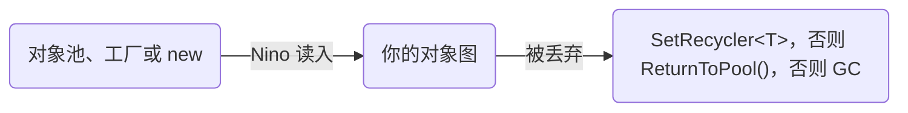

<AnchorRedirect
  map={{
    'creating-instances-with-ninorefdeserialization': '/zh/docs/v4/pooling#creating-instances-with-ninofactory',
  }}
/>

反序列化一个类，通常每次调用都会分配一整套新的对象图。Nino v4 的**复用反序列化**改为填充你已有的对象、复用其中的实例，需要新建的对象则从对象池中取，所以持续不断地反序列化消息或帧，也能做到 **0 B** 分配。[高性能序列化](/zh/docs/v4/advanced/high-performance#levers)把复用列为提速手段之一；这一页讲它的具体规则：哪些会原地填充，新实例从哪里来，丢弃的实例去哪里。

## 选哪种复用方式 [#which-mechanism]

Nino 有三种办法避免为读到的数据分配内存。它们解决的问题不同，也可以一起用：

| 方式 | 适合 | 代价 |
| --- | --- | --- |
| [按 `ref` 反序列化](#deserializing-into-existing-instances) | 一个你留着、反复读入的值（快照、一批数据、一个连接上的上一条消息），并且在下一次读之前处理完 | 不用声明任何东西。实例归你管：读下一条消息时，别的代码不能还拿着它；只有类型相同时才原地填充（槽位里的类型变了，就会新建实例）。 |
| [`[NinoPooled]`](#ninopooled) | Nino 自己新建的实例：时增时减的列表元素、从 `null` 变成有值的成员、交给其他代码、用完再还回来的消息 | 类必须是 `sealed`、`partial`，并实现两个分部方法（NINO018、NINO002、NINO019）。从 Nino 手里拿走的每个实例，你要调用一次 `ReturnToPool()`（调用两次会抛异常）；每个对象池每个线程最多留 64 个实例，共享栈留 256 个。 |
| [`[NinoFactory]`](#creating-instances-with-ninofactory) 加 [`SetRecycler<T>`](#why-setrecycler) | 你已有的对象池（框架自带的池化列表、实体系统），或者不能标 `[NinoPooled]` 的类型（没有 sealed，或者是集合） | 每个类型一个工厂方法；每个声明类型一个<Term id="recycler" lang="zh">回收器</Term>，在启动时、第一次调用之前注册。回收器作用于这个类型的所有槽位，所以只有完全属于反序列化对象图的对象才能经过它。 |

大多数热路径同时用前两种：按 `ref` 反序列化到根对象，再把它的列表和成员会新建的类标成 `[NinoPooled]`，就像下面的[例子](#example)那样。

## 反序列化到已有实例 [#deserializing-into-existing-instances]

`NinoDeserializer.Deserialize(data, ref value)`（自己创建 `Reader` 时用 `Deserialize(ref reader, ref value)`）会原地填充已有的值：

- **目标为 `null`：** 创建新实例，来源见[实例从哪里来](#where-instances-come-from)。
- **已有实例且类型匹配：** 原地填充。列表和数组按索引复用元素，长度与数据相同的 `Memory<T>` 也一样（读入它的数组）；字典按键合并（每个值读入这个键当前对应的值，数据里没有的键直接删除）。
- **字符串：** 已有实例或池化实例中的字符串（成员、列表和数组的元素、字典里已有键的值）与数据内容相同时会直接保留，只有内容变化的字符串才读成新实例。`[NinoUtf8]` 字符串只有文本为 ASCII 时才会保留，非 ASCII 的 UTF-8 文本每次都解码成新字符串。
- **需要重新创建的类型**（标记了 `[NinoConstructor]`，或成员在构造后无法再赋值：构造函数参数、`init` 属性、只读属性或 `readonly` 字段）：创建新实例，丢弃旧实例。参见[重新创建的类型](/zh/docs/v4/constructors#re-created-types)。

```csharp
Snapshot snapshot = null;
while (transport.TryReceive(out ReadOnlyMemory<byte> message)) // 接收缓冲区的视图，不是副本
{
    NinoDeserializer.Deserialize(message.Span, ref snapshot); // 第一条消息构建对象图，之后的消息原地填充
    Apply(snapshot);
}
```

## 实例从哪里来 [#where-instances-come-from]

每当 Nino 需要为某个槽位（成员、集合元素，或你按 `ref` 传入的变量）新建实例时（槽位为 `null`、列表变长、多态槽位的类型改变），实例的来源如下：

| 类型 | 新实例来自 |
| --- | --- |
| `[NinoPooled]` 类 | 内置对象池，见 [`[NinoPooled]`](#ninopooled) |
| 有 `[NinoFactory]` 方法的类型（`[NinoType]` 或集合） | 你的工厂方法，通常从你自己的对象池中取，见[用 `[NinoFactory]` 创建实例](#creating-instances-with-ninofactory) |
| 其他类型（包括普通的 `List<T>`、`Dictionary<K, V>`） | `new` |

## 丢弃的实例去哪里 [#where-dropped-instances-go]



复用反序列化在这些时候丢弃已有实例：数据里这个成员为 `null`、列表变短、数组要重新分配、字典少了某个键、多态槽位的类型改变、只能重新创建的类型换成了新实例。每个丢弃的实例只**交出一次**，交给槽位声明类型对应的回收器：

1. 通过 `NinoSettings.SetRecycler<T>` 为这个声明类型注册的处理函数；否则
2. 如果实例实现了 `INinoPooled`（`[NinoPooled]` 类，或你自己的[池化集合](#your-own-pooled-collections)），调用它的 `ReturnToPool()`；否则
3. 什么也不做，交给 GC。

[自定义格式化器](/zh/docs/v4/custom-formatters#for-a-type-assembly-ninoformatter)丢弃实例时，也通过 `NinoRecycler` 走同样的流程。

### 为什么要注册回收器 [#why-setrecycler]

用 `[NinoFactory]` 从池中借出的对象，它的成员往往也是借来的。比如客户对象借出时就带着一个借来的 `Tags` 列表：

```csharp title="Customer.cs"
using System.Collections.Generic;
using Nino.Core;

[NinoType]
public class Customer
{
    public int Id;
    public List<int> Tags;

    [NinoFactory]
    public static Customer Rent()
    {
        var customer = ObjectPool<Customer>.Rent();
        customer.Tags ??= ObjectPool<List<int>>.Rent(); // 成员也从池中租用
        return customer;
    }
}
```

如果某条消息里 `Tags` 是 `null`，Nino 会把这个列表从客户对象上摘掉。`List<int>` 不知道自己来自哪个池，没有回收器的话它只能交给 GC：这个列表就从池里**漏掉**了，池子越用越空，最后又回到每次都 `new`。注册了回收器，摘下的列表就会还回池中：

```csharp title="Startup.cs"
using System.Collections.Generic;
using Nino.Core;

// 启动时，第一次序列化调用之前
NinoSettings.SetRecycler<List<int>>(list =>
{
    list.Clear();
    ObjectPool<List<int>>.Return(list);
});
NinoSettings.SetRecycler<Customer>(customer => ObjectPool<Customer>.Return(customer)); // 丢弃客户对象本身时
```

`SetRecycler` 只管**还**。之后某条消息里 `Tags` 又有值时，`Customer` 已经存在，不会再调用它的工厂，Nino 会直接 `new List<int>()`：普通 `List<T>` 的创建无法挂接工厂。要让列表的借和还都走池，请使用[池化集合](#your-own-pooled-collections)。

<Callout type="warn">

回收器按**声明类型**注册，对所有声明为这个类型的槽位都生效。只有完全归反序列化出的对象图所有的对象，才应该注册回收器：如果对象图之外的代码还持有某个实例，等池把它再次借出，就会有两处代码共用它。如果两个槽位引用同一个实例，又都丢弃了它，它就会被回收两次（[引用追踪](/zh/docs/v4/reference-tracking)读到的回引用从不回收）。

</Callout>

## 用 `[NinoFactory]` 创建实例 [#creating-instances-with-ninofactory]

给一个公共静态方法加上这个特性：方法不传参数就能调用，返回声明它的类型。只有 Nino 需要这个类型的**新**实例时（槽位是 `null`、列表变长、多态槽位换了类型），才调用它来代替构造函数，然后原地填充拿到的实例；槽位里已经有实例时，直接填充，不调用它。上面的 `Customer.Rent()` 就是一个。再配合复用反序列化，并为 Nino 丢弃的实例注册[回收器](#why-setrecycler)，对象池预热之后，持续不断的消息也不会再分配内存：

```csharp title="Order.cs"
using System.Collections.Generic;
using Nino.Core;

[NinoType]
public sealed class Order
{
    public long Id;
    public List<OrderLine> Lines = new(); // 跟着订单保留，原地复用

    [NinoFactory] // [!code highlight]
    public static Order Rent() => ObjectPool<Order>.Rent(); // ObjectPool<T>：见池化集合

    public void Return()
    {
        Lines.Clear();
        ObjectPool<Order>.Return(this);
    }
}

[NinoType]
public sealed class OrderBatch
{
    public List<Order> Orders;
}

[NinoType]
public struct OrderLine
{
    public int ProductId;
    public int Quantity;
}
```

```csharp
// 启动时：列表变短时丢弃的订单回到对象池
NinoSettings.SetRecycler<Order>(order => order.Return());

OrderBatch batch = null;
foreach (ReadOnlyMemory<byte> message in messages)
    NinoDeserializer.Deserialize(message.Span, ref batch); // 订单变多：Order.Rent()；变少：Return()
```

- 这个方法必须是 `public`、`static`，不传参数就能调用（无参，或参数都有默认值），返回类型正好是声明它的类型；否则报 NINO017。它不能返回 `null`。
- 集合类型也能用（`List<T>` 的子类、`IDictionary<TKey, TValue>` 的实现等）。方法返回的实例里可以还有元素，读数据之前会先丢弃（并回收）这些元素。
- [`ObjectPool<T>`](#your-own-pooled-collections) 是下面那个简单的线程本地对象池，换成别的对象池也行。不需要自己的对象池时，[`[NinoPooled]`](#ninopooled) 会生成一个，丢弃的实例自动还回池里，不用注册回收器。
- 类型有 `[NinoConstructor]` 时，Nino 永远不会调用工厂方法，因为这样的类型总是通过构造函数[重新创建](/zh/docs/v4/constructors#re-created-types)；分析器会报警告（NINO025）。

## 内置对象池：`[NinoPooled]` [#ninopooled]

`[NinoPooled]` 给 `[NinoType]` 类配一个内置的对象池，这样的类就是<Term id="pooled-class" lang="zh">池化类</Term>。无论 Nino 在哪里创建它的实例（你要反序列化的值本身、成员还是集合元素），都会先从池中取一个，再反序列化到这个实例中；丢弃的实例自动还回池中。

```csharp title="Alert.cs"
using System.Collections.Generic;
using System.Linq;
using Nino.Core;

[NinoType, NinoPooled] // [!code highlight]
public sealed partial class Alert
{
    public int DeviceId;
    public float Value;
    public long Timestamp;

    // 必须写；分析器提供一键添加两者的修复（NINO019）。
    private static partial IEnumerable<Alert> OnNinoPoolWarmup() => Enumerable.Range(0, 64).Select(_ => new Alert());
    private partial void OnNinoPoolReturn() { /* 清除 Nino 不反序列化的状态 */ }
}
```

```csharp
var alert = NinoDeserializer.Deserialize<Alert>(bytes); // 池中有实例时复用它
// ……使用它……
alert.ReturnToPool();                                   // 归还两次会抛异常
```

典型用法是作为集合元素：`List<Alert>` 随每条消息变长变短，新增的告警从池中取，丢弃的告警自动还回池中，不需要注册任何回收器。

- 类必须是 `sealed`、`partial`，并且能原地填充（没有只能通过构造函数设置的成员或只读成员）；否则会报告 NINO018/NINO002。
- 生成器会添加 `ReturnToPool()`，以及两个需要你实现的 partial 方法：
  - `OnNinoPoolWarmup()` 在这个类型第一次反序列化之前运行一次，返回的实例直接放进第一个反序列化该类型的线程的池（超过 64 个时，较早的一半移到共享栈；返回 `null` 或空序列则从空池开始）。
  - `OnNinoPoolReturn()` 在 `ReturnToPool()` 时运行：释放 Nino 不会反序列化的状态。
- 同一个实例归还两次会抛出 `InvalidOperationException`。没有归还的实例照常由 GC 回收。
- `ReturnToPool()` 只归还这一个实例。它的列表、数组和嵌套对象（无论是否池化）仍然挂在它身上，下次借出时一起复用。这也意味着：**带着池化子对象的类型本身也应该池化**，否则它被丢弃时，子对象会跟着它一起交给 GC。如果想把某个子对象归还到它自己的池，请在 `OnNinoPoolReturn()` 中归还，并把字段设为 `null`。
- 对象池是线程安全的：每个线程自己最多保留 64 个实例，共享栈默认最多保留 256 个。可以在启动时用 `NinoSettings.PoolMaxRetained` 或 `NinoSettings.SetPoolMaxRetained<T>(int)` 修改上限，按最大的一波高峰来定：上限越大，两次高峰之间留下的实例越多，而且一直占用到进程结束；上限越小，超出池容量的高峰就要为放不下的部分分配内存。
- `NinoPool<T>.Shared` 就是这个池本身：`Count` 是共享栈中的实例数（不含各线程自己保留的），`Clear()` 会丢弃所有池化实例（共享栈立即清空，各线程自己的栈在那个线程下次使用时清空）。

### 池化集合 [#your-own-pooled-collections]

普通 `List<T>` 的创建无法挂接工厂。要让列表本身也走池，可以包装一个对象池，再定义一个实现 `INinoPooled`（命名空间 `Nino.Core`）的列表类型：借出走 `[NinoFactory]`，丢弃时 Nino 调用它的 `ReturnToPool()`，不需要注册回收器。

```csharp title="ObjectPool.cs"
using System;
using System.Collections.Generic;
using Nino.Core;

public static class ObjectPool<T> where T : class, new()
{
    [ThreadStatic] private static Stack<T> _items;

    public static T Rent()
    {
        var items = _items ??= new Stack<T>();
        return items.Count > 0 ? items.Pop() : new T();
    }

    public static void Return(T item) => (_items ??= new Stack<T>()).Push(item);
}

public sealed class PooledList<T> : List<T>, INinoPooled
{
    [NinoFactory] // [!code highlight]
    public static PooledList<T> Rent() => ObjectPool<PooledList<T>>.Rent();

    public void ReturnToPool() // [!code highlight]
    {
        Clear();
        ObjectPool<PooledList<T>>.Return(this);
    }
}
```

成员声明为 `PooledList<int>` 而不是 `List<int>` 即可。已有自己对象池的集合类型（例如 ET 的 `ListComponent<T>`）也是同样的做法。用 `SetRecycler<T>` 为这个类型注册的处理函数优先于 `ReturnToPool()`。

## 完整示例：每条消息 0 GC 的状态同步 [#example]

监控服务器每条消息都发来一组设备的完整状态：设备数量和告警数量每次都在变，设备的最近读数时有时无。下面的文件包含示例用到的全部类型，自带 `Alert` 和 `PooledList<T>`：用它替换上面的 `Alert.cs` 和 `ObjectPool.cs`，不要和它们放在同一个项目里。

```csharp title="Snapshot.cs"
using System;
using System.Collections.Generic;
using System.Linq;
using Nino.Core;

[NinoType]
public class Snapshot
{
    public long Sequence;
    public List<Device> Devices; // 每条消息的长度都不同
    public List<Alert> Alerts;   // 这个也一样
}

[NinoType, NinoPooled]
public sealed partial class Device
{
    public int Id;
    public PooledList<float> Readings; // 有时为 null；设备进入对象池时仍保留在实例上

    private static partial IEnumerable<Device> OnNinoPoolWarmup() => null;
    private partial void OnNinoPoolReturn() { }
}

[NinoType, NinoPooled]
public sealed partial class Alert
{
    public int DeviceId;
    public float Value;
    public long Timestamp;

    private static partial IEnumerable<Alert> OnNinoPoolWarmup() => Enumerable.Range(0, 64).Select(_ => new Alert());
    private partial void OnNinoPoolReturn() { }
}

public sealed class PooledList<T> : List<T>, INinoPooled
{
    [ThreadStatic] private static Stack<PooledList<T>> _pool;

    [NinoFactory] // Readings 为 null 时调用
    public static PooledList<T> Rent() =>
        _pool is { Count: > 0 } ? _pool.Pop() : new PooledList<T>();

    public void ReturnToPool() // Nino 丢弃一个 Readings 列表时调用
    {
        Clear();
        (_pool ??= new Stack<PooledList<T>>()).Push(this);
    }
}
```

```csharp
Snapshot snapshot = null;
foreach (ReadOnlyMemory<byte> message in messages)
    NinoDeserializer.Deserialize(message.Span, ref snapshot);
```

预热完成后，每条消息分配 **0 B**：

- `Snapshot` 和它的两个列表原地复用。
- 列表变长时，新的 `Device` 和 `Alert` 从池中取；变短时，丢弃的元素还回池中，`Device` 连同它的 `Readings` 一起还回。
- `Readings` 变成 `null` 时，`PooledList<float>` 通过 `ReturnToPool()` 还回池中；再次出现时通过 `[NinoFactory]` 借出。

如果 `Device` 没有池化，列表变短时丢弃的 `Device` 会交给 GC，挂在它身上的 `Readings` 也跟着丢失：这样每条消息都还会分配内存，池中的列表也会越来越少。

<Callout type="info">

结合对象池和复用反序列化，反序列化到复用的实例时分配 **0 B**，速度最高比 MemoryPack 的覆盖模式快 <BenchValue k="reuse.max" />。参见[.NET 基准测试](/zh/docs/v4/benchmarks#pooling)。

</Callout>

## 设置 [#settings]

对象池和回收器的设置是 `NinoSettings`（命名空间 `Nino.Core`）的静态成员；它关于不可信数据的限制（`MaxDepth`、`MaxCollectionLength`、`MaxHashCollisions`、`Untrusted`）见[不可信数据](/zh/docs/v4/security#limits)，全部设置一览见[设置](/zh/docs/v4/settings)：

<TypeTable
  type={{
    'SetRecycler<T>(Action<T> handler)': {
      description: '复用反序列化从声明类型为 T 的槽位中丢弃实例时调用的处理函数。对这个声明类型，它会取代“把 [NinoPooled] 实例还回池中”的默认行为。传入 null 可移除。',
      type: 'method',
    },
    PoolMaxRetained: {
      description: '之后新建的每个池，共享栈最多保留多少个实例（池在它的类型第一次反序列化或归还时创建）。',
      type: 'int',
      default: '256',
    },
    'SetPoolMaxRetained<T>(int maxRetained)': {
      description: 'T 的池的共享栈最多保留多少个实例；池可能已经创建时用它。此外每个线程还会各自保留最多 64 个。',
      type: 'method',
    },
  }}
/>

<Callout type="warn">

`NinoSettings` 的值是普通字段，读取时不加同步：请在启动代码中、任何线程第一次序列化之前设置好。

</Callout>

## 常见陷阱 [#pitfalls]

| 错误 | 后果 | 由谁发现 |
| --- | --- | --- |
| 下一次 `Deserialize(data, ref value)` 读入这个实例之后，或者 `ReturnToPool()` 之后，还在用它 | 下一条消息、或者池的下一次借出会覆盖它，而别的代码还拿着它 | 无：读入下一条消息之前先用完；要交给别的代码，就给它一个单独的实例（用完由它归还的池化实例） |
| 同一个实例调用两次 `ReturnToPool()` | 抛 `InvalidOperationException` | 对象池 |
| `[NinoPooled]` 类没有 `sealed`、没有 `partial`，有只读成员或只能通过构造函数设置的成员，或者没实现两个钩子方法 | 编译失败 | NINO018、NINO002、NINO019（有代码修复，可以补上两个钩子方法） |
| `[NinoFactory]` 方法不是 `public static`、有必填参数，或者返回别的类型 | 编译失败 | NINO017 |
| 在有 `[NinoConstructor]` 的类型上用 `[NinoFactory]` | Nino 永远不调用工厂方法：这个类型总是通过构造函数重新创建 | NINO025 |
| 池化的子对象（`[NinoPooled]` 元素、`PooledList<T>`）放在没有池化的类里 | 父对象丢弃时，子对象跟着一起交给 GC，池越用越空 | 无：把父对象也池化 |
| 为一个类型注册了 `SetRecycler<T>`，但对象图之外的代码还持有它的实例 | 那段代码还在用，池就把实例又借出去了 | 无：只为完全属于对象图的对象注册回收器 |
| 第一次调用之后才修改对象池或回收器的设置 | 其他线程可能还看到旧值；`PoolMaxRetained` 只对之后新建的池生效 | 无：在启动时设置（见[设置](#settings)） |

## 下一步 [#next-steps]

<Cards>
  <Card title="零分配模式" href="/zh/docs/v4/advanced/zero-allocation">每次调用 0 B 分配的热路径实践方案。</Card>
  <Card title="构建配置" href="/zh/docs/v4/advanced/build-configuration">按平台列出影响 Nino 速度的编译器、运行时和引擎设置。</Card>
</Cards>
