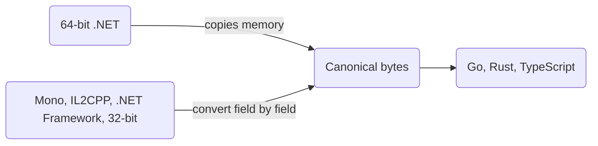

An unmanaged struct that is not a `[NinoType]`, and a raw `[NinoType]` struct, are written as one block of bytes. Runtimes do not agree on how they lay such a struct out in memory: Mono keeps a value tuple's items in declaration order where CoreCLR reorders them, 32-bit runtimes pack 8-byte fields differently, and .NET 8 and .NET 10 hold a `DateTimeOffset` differently. Nino writes every such struct in **one canonical layout**, so the bytes one runtime writes are the bytes every other one reads.

## One Layout, Every Runtime [#canonical]

The canonical layout is the one **64-bit CoreCLR** (.NET on x64 and Arm64) uses, made independent of the .NET version: `DateTimeOffset` as .NET 10 holds it (its offset in minutes as an `int`, then the UTC date), `nint`, `nuint` and pointers as 8 bytes, and the SIMD vectors aligned as on x64 (`Vector<T>` is [not serializable](#vector-t)). Padding bytes are always written as zeros. The [specification](https://github.com/JasonXuDeveloper/Nino/blob/main/docs/spec/wire-format.md#52-the-canonical-layout) gives the rule for every struct, value tuples included.



- **64-bit .NET copies memory.** Where a runtime's layout is the canonical one, which is every struct on .NET x64 and almost every one on Arm64, Nino copies the struct as it lies in memory and clears its padding in the same pass.
- **Every other runtime converts.** Mono, IL2CPP, .NET Framework and 32-bit runtimes find once where their own layout puts each field (reading an instance) and convert each value field by field: widening a 4-byte `nint` to 8 bytes, moving a tuple's items. 64-bit .NET never adapts to them.
- **Go, Rust and TypeScript** read and write the same bytes from the published layout ([Code Generation](/en/docs/v4/advanced/codegen)).

`struct { int A; (int, long) B; }` holding `{1, (2, 3)}` is 24 bytes on every runtime: the tuple's `long` comes before its `int`, as 64-bit .NET places them, even on Mono, which keeps the `int` first in memory.

<Bytes rows={[{ fields: [
  { hex: '01 00 00 00', kind: 'value', label: 'A = 1' },
  { hex: '00 00 00 00', kind: 'pad', label: 'padding to 8' },
  { hex: '03 00 00 00 00 00 00 00', kind: 'value', label: 'B.Item2 (long) = 3' },
  { hex: '02 00 00 00', kind: 'value', label: 'B.Item1 (int) = 2' },
  { hex: '00 00 00 00', kind: 'pad', label: 'padding to 24' },
] }]} />

So data moves both ways between a .NET 10 server, a Unity IL2CPP client on a 32-bit phone, a .NET Framework tool and a Go service. MemoryPack copies an unmanaged struct as it lies in memory: a struct holding `(int, long)` written by .NET on x64 has the `long` first, and Mono, which keeps the `int` first, reads other values from the same bytes ([Nino vs MemoryPack](/en/docs/v4/vs-memorypack)).

## What Differs Between Runtimes [#differences]

The [tables below](#measured-layouts) are measured: CI runs `tests/Nino.RuntimeTests` on each runtime, which prints the size and field offsets of every unmanaged BCL struct, alone and inside a struct `{ byte A; T B; int C; }`, and checks that the runtime writes and reads the bytes CoreCLR x64 wrote for each. Nino's [docs/layouts.md](https://github.com/JasonXuDeveloper/Nino/blob/main/docs/layouts.md) is generated from those CI logs and is the source of these tables. In short:

| Type | 64-bit CoreCLR (the canonical layout) | Where it differs |
| --- | --- | --- |
| Value tuples (`LayoutKind.Auto`) | primitive items first, largest first: `(int, long)` is the `long`, then the `int` | Mono and IL2CPP keep declaration order; 32-bit runtimes and .NET Framework pack them otherwise |
| `DateTimeOffset` | .NET 10: an `int` of minutes at 0, the date at 8 | .NET 8: a `short` at 0; Mono, IL2CPP, .NET Framework: the date first, a `short` at 8 |
| `decimal` | aligned to 8 (Mono too) | aligned to 4 on .NET Framework and IL2CPP |
| A struct holding a tuple or `DateTime` | sequential | .NET Framework lays it out as auto-layout: the fields of `{ byte A; DateTime B; int C; }` move |
| `nint`, `nuint`, pointers, function pointers (`delegate*`) | 8 bytes (`nint` sign-extended, the others zero-extended) | 4 bytes on 32-bit runtimes, which also align some 8-byte fields to 4 (a `DateTime` field on Windows x86); a `delegate*` field is zero-extended on every runtime, Mono and IL2CPP included, because the generated code records it (the generator records the structs declared in its project and in every assembly the project references; a struct no such project references at compile time, such as one in a plugin or HybridCLR hot-update assembly loaded by name, is sign-extended there on 32-bit: [Pitfalls](https://github.com/JasonXuDeveloper/Nino/blob/main/docs/pitfalls.md)) |
| `Vector256<T>`, `Vector512<T>` | aligned to 32 and 64 (x64) | aligned to 16 on Arm64 |
| `Vector<T>` | 16, 32 or 64 bytes, chosen by the CPU | [not serializable](#vector-t) |
| `KeyValuePair`, `Nullable<T>`, `Guid`, `DateTime`, `TimeSpan` | sequential, natural alignment | the same everywhere, except where their items or a runtime's alignment differ |

## What It Costs [#cost]

| Runtime | Raw struct whose layout is canonical there | Raw struct whose layout differs |
| --- | --- | --- |
| 64-bit .NET (x64, Arm64) | a memory copy, padding cleared in the same pass | a field-by-field conversion (Arm64: `Vector256`, `Vector512`) |
| Mono, IL2CPP, .NET Framework, 32-bit | a memory copy | a field-by-field conversion |

Whether a type is copied or converted is decided once per type, before .NET compiles the code that uses it at full speed, as a `static readonly` flag the JIT folds: the fast code of an array, list or value of a canonical struct holds no layout check at all, so 64-bit .NET pays nothing for the other runtimes. A converted struct is not written as one block: arrays and lists of it take a loop over their values instead of a single copy. On Mono and IL2CPP the flag is read once per call.

## What You Should Do [#what-to-do]

<Callout type="warn" title="Raw bytes are copied as they are">

Reading a raw struct copies its block: in the default mode a `bool` field or a `Nullable` flag inside it is not checked, and a byte other than 0 or 1 there is undefined behavior to the .NET JIT (the value can compare unequal to itself). Read data from an untrusted source with `NinoSettings.Untrusted = true` ([What Is Rejected](/en/docs/v4/security#what-is-rejected)).

</Callout>

- **Prefer a `[NinoType]` struct** for data you design: the generator copies it as one block only when its layout is the same on every runtime (checked at compile time), and otherwise writes it member by member with no padding, so no runtime converts anything. A plain struct (no `[NinoType]`) holding tuples, `DateTimeOffset`, `nint` or vectors is still portable, at the cost of a conversion off 64-bit .NET.
- **Order fields largest first** in plain structs you share: fewer padding bytes on the wire.
- **Store fixed lanes, not `Vector<T>`**: it is not serializable; keep a set number of lanes and build the vectors from them ([below](#vector-t)). Go, Rust and TypeScript have no `Vector64<T>` to `Vector512<T>`: nino-gen leaves out types that hold one, with warning NINOGEN002.
- **Godot's math structs** differ between single- and double-precision builds; that is the build's choice, not the runtime's ([Platforms](/en/docs/v4/platforms#godot)).

```csharp
// A plain struct: raw, in the canonical layout. (int, long) is placed as 64-bit .NET places it
// (the long, then the int), and Mono, IL2CPP and 32-bit runtimes convert to it.
public struct Sample
{
    public byte Kind;
    public (int Id, long Ticks) Stamp;
    public float Value;
}

// The same data as a [NinoType] struct: its layout differs on 32-bit runtimes (20 bytes
// there, 24 on 64-bit), so the generator writes it member by member (17 bytes) everywhere.
[NinoType]
public struct SampleRecord
{
    public long Ticks;
    public int Id;
    public float Value;
    public byte Kind;
}
```

## `Vector<T>` Is Not Serializable [#vector-t]

`System.Numerics.Vector<T>` is 16, 32 or 64 bytes, chosen by the CPU (the [specification](https://github.com/JasonXuDeveloper/Nino/blob/main/docs/spec/wire-format.md#3-primitive-and-bcl-values) lists which host has which). No layout carries it between hosts: the 32 bytes an x64 server writes do not fit the 16-byte `Vector<T>` of a phone. So Nino writes no type that is or holds one, alone or inside anything (arrays, collections and classes deriving from one, as in `class Lanes : List<Vector<int>>`, tuples, `T?`, plain structs at any depth). The analyzer reports error NINO029 on the member or the `NinoSerializer`/`NinoDeserializer` call, and a type it did not see (resolved at run time, boxed, from another assembly) throws `NotSupportedException` the first time its formatter is needed, before a byte is written or read; a formatter called by hand (an `UnmanagedFormatter<T>` you create, `Writer.Write`) throws it when it writes or reads the value. `Vector64<T>` to `Vector512<T>` have a fixed size and are serializable.

```csharp expect="NINO029"
[NinoType]
public class Body
{
    public System.Numerics.Vector<float> Velocity; // NINO029
}
```

Store a fixed number of lanes instead, and make the vectors a view over them that Nino does not serialize. 16 lanes of a 4-byte type are 64 bytes, the widest `Vector<T>`, so they split into whole vectors on every CPU (4, 2 or 1 of them): the code never assumes `Vector<float>.Count` is 8, and the bytes are the same on every host.

```csharp title="Particle.cs"
using System;
using System.Numerics;
using System.Runtime.InteropServices;
using Nino.Core;

[NinoType]
public sealed partial class Particle
{
    public int Id;

    // Serialized: 16 floats, 64 bytes on every host. 16 is a multiple of Vector<float>.Count everywhere (4, 8 or 16).
    public float[] Lanes = new float[16];

    // Not serialized: the same lanes as Vector<float>s, 4, 2 or 1 of them depending on the CPU.
    [NinoIgnore]
    public Span<Vector<float>> Vectors => MemoryMarshal.Cast<float, Vector<float>>(Lanes.AsSpan());

    // Not serialized: the first Vector<float>.Count lanes (4, 8 or 16 of them) as one vector.
    [NinoIgnore]
    public Vector<float> Head
    {
        get => Vectors[0];
        set => Vectors[0] = value;
    }

    public void Scale(float factor)
    {
        foreach (ref var vector in Vectors)
            vector *= factor;
    }
}
```

`Vectors` is a span, a ref struct, which Nino could not write anyway; `[NinoIgnore]` says it is meant. `Head` has a setter, so without `[NinoIgnore]` Nino would collect it and report NINO029. After reading data you do not trust, check `Lanes.Length` before taking the view: a shorter array makes fewer vectors. `Vector128<T>` or `Vector256<T>` fields (.NET only, not Unity) or a fixed buffer serve as the stored form too.

## Measured Layouts [#measured-layouts]

Measured by Nino's CI (run 41280617045, `tests/Nino.RuntimeTests`): .NET 10 on Linux x64 and Arm64, Windows x86 and Linux Arm32 (under qemu), .NET Framework 4.8 64-bit and 32-bit, Mono 6.14 on Linux x64 and Arm64. The CoreCLR x64 column is the canonical layout, with two exceptions that do not depend on the runtime: `DateTimeOffset` as .NET 10 lays it out, and `nint`/`nuint` as 8 bytes. The last column names only the runtimes whose layout differs from CoreCLR x64, in **bold** (size, then offsets in field order), or that do not have the type; every runtime it does not name has CoreCLR x64's size and field offsets, and — means every runtime does. "32-bit CoreCLR" means x86 and Arm32, "Mono" Mono on x64 and Arm64, ".NET Framework" its 64-bit and 32-bit runs. Field names differ between runtimes; offsets are what count. Every runtime in these tables writes and reads CoreCLR x64's bytes for each type, checked in the same CI run.

### Each Type: Size, Then the Offset of Each Field [#each-type]

| Type | CoreCLR x64 | Where it differs |
| --- | --- | --- |
| `(int,long)` | 16: Item1 8, Item2 0 | **12: 8, 0** on CoreCLR x86 and .NET Framework x86; **16: 0, 8** on Mono |
| `(long,int)` | 16: Item1 0, Item2 8 | **12: 0, 8** on CoreCLR x86 and .NET Framework x86 |
| `(byte,short)` | 4: Item1 2, Item2 0 | **4: 0, 2** on Mono |
| `(byte,long,int)` | 16: Item1 12, Item2 0, Item3 8 | **24: 0, 8, 16** on Mono |
| `(byte,int,short)` | 8: Item1 6, Item2 0, Item3 4 | **12: 0, 4, 8** on Mono |
| `(short,byte,int)` | 8: Item1 4, Item2 6, Item3 0 | **8: 0, 2, 4** on Mono |
| `(int,int)` | 8: Item1 0, Item2 4 | — |
| `(int,int,int)` | 16: Item1 0, Item2 4, Item3 8 | **12: 0, 4, 8** on 32-bit CoreCLR, .NET Framework x86 and Mono |
| `(byte,byte,byte)` | 4: Item1 0, Item2 1, Item3 2 | **3: 0, 1, 2** on Mono |
| `(bool,char,byte)` | 4: Item1 2, Item2 0, Item3 3 | **6: 0, 2, 4** on Mono |
| `(double,float)` | 16: Item1 0, Item2 8 | **12: 0, 8** on CoreCLR x86 and .NET Framework x86 |
| `(Tag,long)` | 16: Item1 8, Item2 0 | **12: 8, 0** on CoreCLR x86 and .NET Framework x86; **16: 0, 8** on Mono |
| `(int,IntPtr)` | 16: Item1 8, Item2 0 | **8: 0, 4** on 32-bit CoreCLR and .NET Framework x86; **16: 0, 8** on Mono |
| `(byte,UIntPtr)` | 16: Item1 8, Item2 0 | **8: 4, 0** on 32-bit CoreCLR and .NET Framework x86; **16: 0, 8** on Mono |
| `ValueTuple<long>` | 8: Item1 0 | — |
| `(int,DateTime)` | 16: Item1 0, Item2 8 | **12: 0, 4** on CoreCLR x86 and .NET Framework x86 |
| `(byte,DateTime,int)` | 16: Item1 4, Item2 8, Item3 0 | **24: 0, 8, 16** on Mono |
| `(int,TimeSpan)` | 16: Item1 0, Item2 8 | **12: 0, 4** on .NET Framework x86 |
| `(byte,decimal)` | 24: Item1 0, Item2 8 | **20: 0, 4** on .NET Framework x86 |
| `(int,decimal)` | 24: Item1 0, Item2 8 | **20: 0, 4** on .NET Framework x86 |
| `(byte,Guid)` | 24: Item1 0, Item2 4 | **20: 0, 4** on 32-bit CoreCLR, .NET Framework x86 and Mono; **24: 0, 8** on .NET Framework x64 |
| `(byte,int?)` | 16: Item1 0, Item2 4 | **12: 0, 4** on 32-bit CoreCLR, .NET Framework x86 and Mono; **16: 0, 8** on .NET Framework x64 |
| `(long?,byte)` | 24: Item1 8, Item2 0 | **20: 4, 0** on .NET Framework x86; **24: 0, 16** on Mono |
| `(byte,(int,long))` | 24: Item1 0, Item2 8 | **16: 0, 4** on CoreCLR x86 and .NET Framework x86 |
| `((byte,short),long)` | 16: Item1 8, Item2 0 | **12: 8, 0** on CoreCLR x86 and .NET Framework x86; **16: 0, 8** on Mono |
| `(int,(byte,short),long)` | 16: Item1 8, Item2 12, Item3 0 | **24: 8, 16, 0** on .NET Framework x64; **16: 0, 4, 8** on Mono |
| `(int,KVP<int,long>)` | 24: Item1 0, Item2 8 | **20: 0, 4** on .NET Framework x86 |
| `(byte,DateTimeOffset)` | 24: Item1 0, Item2 8 | **16: 0, 4** on CoreCLR x86 and .NET Framework x86 |
| `(byte,short,int,long,byte,short,int)` | 24: Item1 20, Item2 16, Item3 8, Item4 0, Item5 21, Item6 18, Item7 12 | **24: 0, 2, 4, 8, 16, 18, 20** on Mono |
| `(byte,long,byte,long,byte,long,byte,int)` | 32: Item1 24, Item2 0, Item3 25, Item4 8, Item5 26, Item6 16, Item7 27, Rest 28 | **40: 24, 0, 25, 8, 26, 16, 27, 32** on .NET Framework x64; **56: 0, 8, 16, 24, 32, 40, 48, 52** on Mono |
| `(int,(byte,long),(short,(byte,int)))` | 40: Item1 0, Item2 8, Item3 24 | **28: 0, 4, 16** on CoreCLR x86 and .NET Framework x86 |
| `KVP<int,long>` | 16: key 0, value 8 | — |
| `KVP<byte,long>` | 16: key 0, value 8 | — |
| `KVP<long,byte>` | 16: key 0, value 8 | — |
| `KVP<int,DateTime>` | 16: key 0, value 8 | **12: 0, 4** on CoreCLR x86 and .NET Framework x86 |
| `KVP<byte,(int,long)>` | 24: key 0, value 8 | **16: 0, 4** on CoreCLR x86 and .NET Framework x86 |
| `DateTimeOffset` | 16: _dateTime 8, _offsetMinutes 0 | **12: 4, 0** on CoreCLR x86 and .NET Framework x86; **16: 0, 8** on Mono |
| `DateTime` | 8: _dateData 0 | — |
| `TimeSpan` | 8: _ticks 0 | — |
| `decimal` | 16: _flags 0, _hi32 4, _lo64 8 | **16: 0, 4, 8, 12** on .NET Framework; **16: 0, 4, 8, 12, 8** on Mono |
| `Guid` | 16: _a 0, _b 4, _c 6, _d 8, _e 9, _f 10, _g 11, _h 12, _i 13, _j 14, _k 15 | — |
| `int?` | 8: hasValue 0, value 4 | — |
| `long?` | 16: hasValue 0, value 8 | — |
| `(int,long)?` | 24: hasValue 0, value 8 | **16: 0, 4** on CoreCLR x86 and .NET Framework x86 |
| `DateTimeOffset?` | 24: hasValue 0, value 8 | **16: 0, 4** on CoreCLR x86 and .NET Framework x86 |
| `IntPtr` | 8: _value 0 | **4: 0** on 32-bit CoreCLR; **4** on .NET Framework x86 |
| `Complex` | 16: m_real 0, m_imaginary 8 | — |
| `Int128` | 16: _lower 0, _upper 8 | not in .NET Framework or Mono |
| `(byte,Int128)` | 32: Item1 0, Item2 16 | **24: 0, 8** on CoreCLR Arm32; not in .NET Framework or Mono |
| `Half` | 2: _value 0 | not in .NET Framework or Mono |
| `(byte,Half)` | 4: Item1 0, Item2 2 | not in .NET Framework or Mono |
| `DateOnly` | 4: _dayNumber 0 | not in .NET Framework or Mono |
| `TimeOnly` | 8: _ticks 0 | not in .NET Framework or Mono |
| `(byte,DateOnly,TimeOnly)` | 16: Item1 0, Item2 4, Item3 8 | not in .NET Framework or Mono |
| `Range` | 8: Start 0, End 4 | not in .NET Framework or Mono |
| `Index` | 4: _value 0 | not in .NET Framework or Mono |
| `Rune` | 4: _value 0 | not in .NET Framework or Mono |
| `Vector2` | 8: X 0, Y 4 | not in .NET Framework or Mono |
| `Vector3` | 12: X 0, Y 4, Z 8 | not in .NET Framework or Mono |
| `Vector4` | 16: X 0, Y 4, Z 8, W 12 | not in .NET Framework or Mono |
| `Quaternion` | 16: X 0, Y 4, Z 8, W 12 | not in .NET Framework or Mono |
| `Plane` | 16: Normal 0, D 12 | not in .NET Framework or Mono |
| `Matrix3x2` | 24: M11 0, M12 4, M21 8, M22 12, M31 16, M32 20 | not in .NET Framework or Mono |
| `Matrix4x4` | 64: M11 0, M12 4, M13 8, M14 12, M21 16, M22 20, M23 24, M24 28, M31 32, M32 36, M33 40, M34 44, M41 48, M42 52, M43 56, M44 60 | not in .NET Framework or Mono |
| `Vector64<int>` | 8: _00 0 | not in .NET Framework or Mono |
| `Vector128<int>` | 16: _lower 0, _upper 8 | not in .NET Framework or Mono |
| `Vector256<long>` | 32: _lower 0, _upper 16 | not in .NET Framework or Mono |
| `Vector512<long>` | 64: _lower 0, _upper 32 | not in .NET Framework or Mono |

### Inside `Around<T> { byte A; T B; int C; }`: Size, Then the Offsets of A, B and C [#around]

| Type | CoreCLR x64 | Where it differs |
| --- | --- | --- |
| `(int,long)` | 32: 0, 8, 24 | **20: 0, 4, 16** on CoreCLR x86; **24: 4, 8, 0** on .NET Framework x64; **20: 4, 8, 0** on .NET Framework x86 |
| `(long,int)` | 32: 0, 8, 24 | **20: 0, 4, 16** on CoreCLR x86; **24: 4, 8, 0** on .NET Framework x64; **20: 4, 8, 0** on .NET Framework x86 |
| `(byte,short)` | 12: 0, 4, 8 | **16: 4, 8, 0** on .NET Framework x64; **12: 4, 8, 0** on .NET Framework x86; **12: 0, 2, 8** on Mono |
| `(byte,long,int)` | 32: 0, 8, 24 | **24: 0, 4, 20** on CoreCLR x86; **24: 4, 8, 0** on .NET Framework; **40: 0, 8, 32** on Mono |
| `(byte,int,short)` | 24: 0, 8, 16 | **16: 0, 4, 12** on 32-bit CoreCLR; **16: 4, 8, 0** on .NET Framework; **20: 0, 4, 16** on Mono |
| `(short,byte,int)` | 24: 0, 8, 16 | **16: 0, 4, 12** on 32-bit CoreCLR and Mono; **16: 4, 8, 0** on .NET Framework |
| `(int,int)` | 24: 0, 8, 16 | **16: 0, 4, 12** on 32-bit CoreCLR and Mono; **16: 4, 8, 0** on .NET Framework |
| `(int,int,int)` | 32: 0, 8, 24 | **20: 0, 4, 16** on 32-bit CoreCLR and Mono; **24: 4, 8, 0** on .NET Framework x64; **20: 4, 8, 0** on .NET Framework x86 |
| `(byte,byte,byte)` | 12: 0, 4, 8 | **16: 4, 8, 0** on .NET Framework x64; **12: 4, 8, 0** on .NET Framework x86; **8: 0, 1, 4** on Mono |
| `(bool,char,byte)` | 12: 0, 4, 8 | **16: 4, 8, 0** on .NET Framework x64; **12: 4, 8, 0** on .NET Framework x86; **12: 0, 2, 8** on Mono |
| `(double,float)` | 32: 0, 8, 24 | **20: 0, 4, 16** on CoreCLR x86; **24: 4, 8, 0** on .NET Framework x64; **20: 4, 8, 0** on .NET Framework x86 |
| `(Tag,long)` | 32: 0, 8, 24 | **20: 0, 4, 16** on CoreCLR x86; **24: 4, 8, 0** on .NET Framework x64; **20: 4, 8, 0** on .NET Framework x86 |
| `(int,IntPtr)` | 32: 0, 8, 24 | **16: 0, 4, 12** on 32-bit CoreCLR; **24: 4, 8, 0** on .NET Framework x64; **16: 4, 8, 0** on .NET Framework x86 |
| `(byte,UIntPtr)` | 32: 0, 8, 24 | **16: 0, 4, 12** on 32-bit CoreCLR; **24: 4, 8, 0** on .NET Framework x64; **16: 4, 8, 0** on .NET Framework x86 |
| `ValueTuple<long>` | 24: 0, 8, 16 | — |
| `(int,DateTime)` | 32: 0, 8, 24 | **20: 0, 4, 16** on CoreCLR x86; **24: 4, 8, 0** on .NET Framework x64; **20: 4, 8, 0** on .NET Framework x86 |
| `(byte,DateTime,int)` | 32: 0, 8, 24 | **24: 0, 4, 20** on CoreCLR x86; **24: 4, 8, 0** on .NET Framework; **40: 0, 8, 32** on Mono |
| `(int,TimeSpan)` | 32: 0, 8, 24 | **24: 4, 8, 0** on .NET Framework x64; **20: 4, 8, 0** on .NET Framework x86 |
| `(byte,decimal)` | 40: 0, 8, 32 | **32: 4, 8, 0** on .NET Framework x64; **28: 4, 8, 0** on .NET Framework x86 |
| `(int,decimal)` | 40: 0, 8, 32 | **32: 4, 8, 0** on .NET Framework x64; **28: 4, 8, 0** on .NET Framework x86 |
| `(byte,Guid)` | 40: 0, 8, 32 | **28: 0, 4, 24** on 32-bit CoreCLR and Mono; **32: 4, 8, 0** on .NET Framework x64; **28: 4, 8, 0** on .NET Framework x86 |
| `(byte,int?)` | 32: 0, 8, 24 | **20: 0, 4, 16** on 32-bit CoreCLR and Mono; **24: 4, 8, 0** on .NET Framework x64; **20: 4, 8, 0** on .NET Framework x86 |
| `(long?,byte)` | 40: 0, 8, 32 | **32: 4, 8, 0** on .NET Framework x64; **28: 4, 8, 0** on .NET Framework x86 |
| `(byte,(int,long))` | 40: 0, 8, 32 | **24: 0, 4, 20** on CoreCLR x86; **32: 4, 8, 0** on .NET Framework x64; **24: 4, 8, 0** on .NET Framework x86 |
| `((byte,short),long)` | 32: 0, 8, 24 | **20: 0, 4, 16** on CoreCLR x86; **24: 4, 8, 0** on .NET Framework x64; **20: 4, 8, 0** on .NET Framework x86 |
| `(int,(byte,short),long)` | 32: 0, 8, 24 | **24: 0, 4, 20** on CoreCLR x86; **32: 4, 8, 0** on .NET Framework x64; **24: 4, 8, 0** on .NET Framework x86 |
| `(int,KVP<int,long>)` | 40: 0, 8, 32 | **32: 4, 8, 0** on .NET Framework x64; **28: 4, 8, 0** on .NET Framework x86 |
| `(byte,DateTimeOffset)` | 40: 0, 8, 32 | **24: 0, 4, 20** on CoreCLR x86; **32: 4, 8, 0** on .NET Framework x64; **24: 4, 8, 0** on .NET Framework x86 |
| `(byte,short,int,long,byte,short,int)` | 40: 0, 8, 32 | **32: 0, 4, 28** on CoreCLR x86; **32: 4, 8, 0** on .NET Framework |
| `(byte,long,byte,long,byte,long,byte,int)` | 48: 0, 8, 40 | **40: 0, 4, 36** on CoreCLR x86; **48: 4, 8, 0** on .NET Framework x64; **40: 4, 8, 0** on .NET Framework x86; **72: 0, 8, 64** on Mono |
| `(int,(byte,long),(short,(byte,int)))` | 56: 0, 8, 48 | **36: 0, 4, 32** on CoreCLR x86; **48: 4, 8, 0** on .NET Framework x64; **36: 4, 8, 0** on .NET Framework x86 |
| `KVP<int,long>` | 32: 0, 8, 24 | — |
| `KVP<byte,long>` | 32: 0, 8, 24 | — |
| `KVP<long,byte>` | 32: 0, 8, 24 | — |
| `KVP<int,DateTime>` | 32: 0, 8, 24 | **20: 0, 4, 16** on CoreCLR x86; **24: 4, 8, 0** on .NET Framework x64; **20: 4, 8, 0** on .NET Framework x86 |
| `KVP<byte,(int,long)>` | 40: 0, 8, 32 | **24: 0, 4, 20** on CoreCLR x86; **32: 4, 8, 0** on .NET Framework x64; **24: 4, 8, 0** on .NET Framework x86 |
| `DateTimeOffset` | 32: 0, 8, 24 | **20: 0, 4, 16** on CoreCLR x86; **24: 4, 8, 0** on .NET Framework x64; **20: 4, 8, 0** on .NET Framework x86 |
| `DateTime` | 24: 0, 8, 16 | **16: 0, 4, 12** on CoreCLR x86; **16: 4, 8, 0** on .NET Framework |
| `TimeSpan` | 24: 0, 8, 16 | — |
| `decimal` | 32: 0, 8, 24 | **24: 0, 4, 20** on .NET Framework |
| `Guid` | 24: 0, 4, 20 | — |
| `int?` | 16: 0, 4, 12 | — |
| `long?` | 32: 0, 8, 24 | — |
| `(int,long)?` | 40: 0, 8, 32 | **24: 0, 4, 20** on CoreCLR x86; **32: 4, 8, 0** on .NET Framework x64; **24: 4, 8, 0** on .NET Framework x86 |
| `DateTimeOffset?` | 40: 0, 8, 32 | **24: 0, 4, 20** on CoreCLR x86; **32: 4, 8, 0** on .NET Framework x64; **24: 4, 8, 0** on .NET Framework x86 |
| `IntPtr` | 24: 0, 8, 16 | **12: 0, 4, 8** on 32-bit CoreCLR and .NET Framework x86 |
| `Complex` | 32: 0, 8, 24 | — |
| `Int128` | 48: 0, 16, 32 | **32: 0, 8, 24** on CoreCLR Arm32; not in .NET Framework or Mono |
| `(byte,Int128)` | 64: 0, 16, 48 | **40: 0, 8, 32** on CoreCLR Arm32; not in .NET Framework or Mono |
| `Half` | 8: 0, 2, 4 | not in .NET Framework or Mono |
| `(byte,Half)` | 12: 0, 4, 8 | not in .NET Framework or Mono |
| `DateOnly` | 12: 0, 4, 8 | not in .NET Framework or Mono |
| `TimeOnly` | 24: 0, 8, 16 | not in .NET Framework or Mono |
| `(byte,DateOnly,TimeOnly)` | 32: 0, 8, 24 | not in .NET Framework or Mono |
| `Range` | 16: 0, 4, 12 | not in .NET Framework or Mono |
| `Index` | 12: 0, 4, 8 | not in .NET Framework or Mono |
| `Rune` | 12: 0, 4, 8 | not in .NET Framework or Mono |
| `Vector2` | 16: 0, 4, 12 | not in .NET Framework or Mono |
| `Vector3` | 20: 0, 4, 16 | not in .NET Framework or Mono |
| `Vector4` | 24: 0, 4, 20 | not in .NET Framework or Mono |
| `Quaternion` | 24: 0, 4, 20 | not in .NET Framework or Mono |
| `Plane` | 24: 0, 4, 20 | not in .NET Framework or Mono |
| `Matrix3x2` | 32: 0, 4, 28 | not in .NET Framework or Mono |
| `Matrix4x4` | 72: 0, 4, 68 | not in .NET Framework or Mono |
| `Vector64<int>` | 24: 0, 8, 16 | not in .NET Framework or Mono |
| `Vector128<int>` | 48: 0, 16, 32 | **32: 0, 8, 24** on CoreCLR Arm32; not in .NET Framework or Mono |
| `Vector256<long>` | 96: 0, 32, 64 | **64: 0, 16, 48** on CoreCLR Arm64; **48: 0, 8, 40** on CoreCLR Arm32; not in .NET Framework or Mono |
| `Vector512<long>` | 192: 0, 64, 128 | **96: 0, 16, 80** on CoreCLR Arm64; **80: 0, 8, 72** on CoreCLR Arm32; not in .NET Framework or Mono |

### Unity: Mono and IL2CPP [#unity]

Unity's tests log the layouts of a few types (CI: Unity 2022.3 and 6000.3, the editor's Mono and a Linux x64 IL2CPP player, the same on all four), and check CoreCLR's bytes for every case above in the editor and the IL2CPP player. `Vector<T>` is 16 bytes there, one reason it is [not serializable](#vector-t). `=` is the same size and field offsets as CoreCLR x64; a **bold** cell differs.

| Type | CoreCLR x64 | Unity Mono and IL2CPP |
| --- | --- | --- |
| `(int,long)` | 16: Item1 8, Item2 0 | **16: 0, 8** |
| `(byte,short)` | 4: Item1 2, Item2 0 | **4: 0, 2** |
| `(byte,long,int)` | 16: Item1 12, Item2 0, Item3 8 | **24: 0, 8, 16** |
| `KeyValuePair<int,long>` | 16 | = |
| `DateTimeOffset` | 16: minutes 0 (`int`), UTC 8 | **16: UTC 0, minutes 8 (`short`)** |
| `Around<(int,long)>` | 32 | = |

## Related [#related]

<Cards>
  <Card title="Platforms" href="/en/docs/v4/platforms" description="Where Nino runs and why every target writes the same bytes." />
  <Card title="Wire Format" href="/en/docs/v4/wire-format#raw-values" description="Raw values and the canonical layout, byte by byte." />
  <Card title="Nino vs MemoryPack" href="/en/docs/v4/vs-memorypack" description="Copies of memory against one defined layout." />
</Cards>
