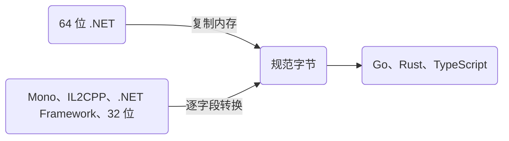

没有标 `[NinoType]` 的非托管结构体，以及原始的 `[NinoType]` 结构体，都按一整块字节写出。各运行时在内存里排布这种结构体的方式并不一致：CoreCLR 会重排值元组的项，Mono 按声明顺序放；32 位运行时对 8 字节字段的对齐不同；.NET 8 和 .NET 10 存 `DateTimeOffset` 的方式不同。Nino 把这些结构体统一写成**一种规范布局**，一个运行时写的字节，其他运行时都能读。

## 一种布局，所有运行时 [#canonical]

规范布局就是 **64 位 CoreCLR**（x64 和 Arm64 上的 .NET）用的布局，并且不随 .NET 版本变化：`DateTimeOffset` 按 .NET 10 的存法（先是 `int` 型的分钟偏移，再是 UTC 时间），`nint`、`nuint` 和指针一律 8 字节，各个 SIMD 向量按 x64 的方式对齐（`Vector<T>` [不能序列化](#vector-t)）。填充字节总是写成 0。每种结构体（含值元组）的规则见[规范](https://github.com/JasonXuDeveloper/Nino/blob/main/docs/spec/wire-format.md#52-the-canonical-layout)。



- **64 位 .NET 直接复制内存。** 运行时的布局和规范布局相同时（.NET x64 上的全部结构体，Arm64 上几乎全部），Nino 按内存原样复制，复制的同时清零填充。
- **其他运行时负责转换。** Mono、IL2CPP、.NET Framework 和 32 位运行时先读一个实例，找出自己把每个字段放在哪里（只找一次），再逐字段转换：把 4 字节的 `nint` 扩成 8 字节，挪动元组的项。64 位 .NET 从不迁就它们。
- **Go、Rust 和 TypeScript** 按发布的布局读写同样的字节（[代码生成](/zh/docs/v4/advanced/codegen)）。

`struct { int A; (int, long) B; }` 存 `{1, (2, 3)}` 时，在每个运行时上都是 24 字节：元组的 `long` 在 `int` 前面，和 64 位 .NET 的放法一样；Mono 在内存里把 `int` 放在前面，写出的字节也照样如此。

<Bytes rows={[{ fields: [
  { hex: '01 00 00 00', kind: 'value', label: 'A = 1' },
  { hex: '00 00 00 00', kind: 'pad', label: '填充到 8' },
  { hex: '03 00 00 00 00 00 00 00', kind: 'value', label: 'B.Item2（long）= 3' },
  { hex: '02 00 00 00', kind: 'value', label: 'B.Item1（int）= 2' },
  { hex: '00 00 00 00', kind: 'pad', label: '填充到 24' },
] }]} />

所以数据可以在 .NET 10 服务器、32 位手机上的 Unity IL2CPP 客户端、.NET Framework 工具和 Go 服务之间双向流动。MemoryPack 按内存原样复制非托管结构体：在 x64 的 .NET 上写一个含 `(int, long)` 的结构体，`long` 在前；Mono 把 `int` 放在前面，读同样的字节会得到别的值（[Nino 对比 MemoryPack](/zh/docs/v4/vs-memorypack)）。

## 各运行时有哪些不同 [#differences]

[下面的表格](#measured-layouts)都是实测的：CI 在每个运行时上跑 `tests/Nino.RuntimeTests`，打印每个非托管 BCL 结构体单独和放在 `{ byte A; T B; int C; }` 里时的大小和字段偏移，并检查这个运行时写出、读入的字节和 CoreCLR x64 写的一致。Nino 仓库的 [docs/layouts.md](https://github.com/JasonXuDeveloper/Nino/blob/main/docs/layouts.md) 由这些 CI 日志生成，是这些表格的来源。简单说：

| 类型 | 64 位 CoreCLR（规范布局） | 哪里不同 |
| --- | --- | --- |
| 值元组（`LayoutKind.Auto`） | 先放基元类型的项，大的在前：`(int, long)` 是先 `long` 后 `int` | Mono 和 IL2CPP 按声明顺序；32 位运行时和 .NET Framework 又是另一种排法 |
| `DateTimeOffset` | .NET 10：0 处是 `int` 型分钟数，8 处是时间 | .NET 8：0 处是 `short`；Mono、IL2CPP、.NET Framework：先放时间，8 处放 `short` |
| `decimal` | 按 8 对齐（Mono 也是） | .NET Framework 和 IL2CPP 上按 4 对齐 |
| 含元组或 `DateTime` 的结构体 | 顺序布局 | .NET Framework 把它当成自动布局：`{ byte A; DateTime B; int C; }` 的字段会换位置 |
| `nint`、`nuint`、指针、函数指针（`delegate*`） | 8 字节（`nint` 符号扩展，其余零扩展） | 32 位运行时上是 4 字节，部分 8 字节字段也按 4 对齐（Windows x86 上的 `DateTime` 字段）；`delegate*` 字段在所有运行时（包括 Mono 和 IL2CPP）都零扩展，因为生成的代码记录了它（生成器记录本项目及其引用的每个程序集中声明的结构体；没有任何这样的项目在编译时引用的结构体，例如按名称加载的插件或 HybridCLR 热更新程序集中的结构体，在 32 位上仍会符号扩展：[常见陷阱](https://github.com/JasonXuDeveloper/Nino/blob/main/docs/pitfalls.md)） |
| `Vector256<T>`、`Vector512<T>` | 按 32 和 64 对齐（x64） | Arm64 上按 16 对齐 |
| `Vector<T>` | 16、32 或 64 字节，由 CPU 决定 | [不能序列化](#vector-t) |
| `KeyValuePair`、`Nullable<T>`、`Guid`、`DateTime`、`TimeSpan` | 顺序布局，自然对齐 | 各处一致，除非它们的项或运行时的对齐不同 |

## 开销 [#cost]

| 运行时 | 布局等于规范布局的原始结构体 | 布局不同的原始结构体 |
| --- | --- | --- |
| 64 位 .NET（x64、Arm64） | 一次内存复制，同时清零填充 | 逐字段转换（Arm64 上：`Vector256`、`Vector512`） |
| Mono、IL2CPP、.NET Framework、32 位 | 一次内存复制 | 逐字段转换 |

复制还是转换，每个类型只判断一次，在 .NET 用全速编译使用它的代码之前就定下来，是一个 JIT 能折叠掉的 `static readonly` 标志：规范结构体的数组、列表和单个值，全速代码里根本没有布局判断，64 位 .NET 不为其他运行时付出任何代价。需要转换的结构体不能整块写出：它的数组和列表要逐个值循环，不能一次复制。Mono 和 IL2CPP 每次调用读一次这个标志。

## 你该怎么做 [#what-to-do]

<Callout type="warn" title="原始字节按原样复制">

读原始结构体就是复制它的整块字节：默认模式下，里面的 `bool` 字段和 `Nullable` 存在字节都不检查，那里出现不是 0 或 1 的字节，对 .NET JIT 是未定义行为（这个值可能和自己都不相等）。来源不可信的数据，要设 `NinoSettings.Untrusted = true` 再读（见[会被拒绝的数据](/zh/docs/v4/security#what-is-rejected)）。

</Callout>

- **自己设计的数据，优先用 `[NinoType]` 结构体**：只有当它在所有运行时上布局都相同时（编译时检查），生成器才整块复制，否则逐成员写出、没有填充，任何运行时都不用转换。不标 `[NinoType]` 的普通结构体里放元组、`DateTimeOffset`、`nint` 或向量，同样可移植，只是在 64 位 .NET 以外要付转换的开销。
- **共享的普通结构体，字段按从大到小排**：线上的填充字节更少。
- **存固定的通道，不要存 `Vector<T>`**：它不能序列化；存固定数量的通道，再由它们构造向量（见[下文](#vector-t)）。Go、Rust 和 TypeScript 没有 `Vector64<T>` 到 `Vector512<T>`：nino-gen 会跳过含它们的类型，并报 NINOGEN002 警告。
- **Godot 的数学结构体**在单精度和双精度构建里布局不同；这由构建决定，跟运行时无关（[平台](/zh/docs/v4/platforms#godot)）。

```csharp
// 普通结构体：原始值，按规范布局写。(int, long) 按 64 位 .NET 的方式放（先 long 后 int），
// Mono、IL2CPP 和 32 位运行时转换成这种布局。
public struct Sample
{
    public byte Kind;
    public (int Id, long Ticks) Stamp;
    public float Value;
}

// 同样的数据写成 [NinoType] 结构体：它在 32 位运行时上的布局不同（那里 20 字节，64 位上 24 字节），
// 所以生成器在所有平台上都逐成员写出（17 字节）。
[NinoType]
public struct SampleRecord
{
    public long Ticks;
    public int Id;
    public float Value;
    public byte Kind;
}
```

## `Vector<T>` 不能序列化 [#vector-t]

`System.Numerics.Vector<T>` 是 16、32 或 64 字节，由 CPU 决定（哪种主机是多少，见[规范](https://github.com/JasonXuDeveloper/Nino/blob/main/docs/spec/wire-format.md#3-primitive-and-bcl-values)）。没有哪种布局能让它在各平台之间通用：x64 服务器写出的 32 字节，放不进手机上 16 字节的 `Vector<T>`。所以 Nino 不写任何本身是或含有 `Vector<T>` 的类型，无论它单独出现还是在别的类型里（数组、集合及继承集合的类，例如 `class Lanes : List<Vector<int>>`、元组、`T?`、任意深度的普通结构体）。分析器会在成员或 `NinoSerializer`/`NinoDeserializer` 调用上报错误 NINO029；分析器没看到的类型（运行时解析的、装箱的、来自别的程序集的），在第一次需要它的格式化器时抛 `NotSupportedException`，不会写出或读入任何字节；手动调用格式化器（自己创建的 `UnmanagedFormatter<T>`、`Writer.Write`）时，写入或读取这个值时抛同样的异常。`Vector64<T>` 到 `Vector512<T>` 大小固定，可以序列化。

```csharp expect="NINO029"
[NinoType]
public class Body
{
    public System.Numerics.Vector<float> Velocity; // NINO029
}
```

改为存固定数量的通道，再在它们之上提供 Nino 不序列化的向量视图。16 个 4 字节的通道是 64 字节，也就是最宽的 `Vector<T>`，所以在任何 CPU 上都正好切成整数个向量（4 个、2 个或 1 个）：代码不必假设 `Vector<float>.Count` 是 8，各平台上的字节也完全相同。

```csharp title="Particle.cs"
using System;
using System.Numerics;
using System.Runtime.InteropServices;
using Nino.Core;

[NinoType]
public sealed partial class Particle
{
    public int Id;

    // 会序列化：16 个 float，在所有平台上都是 64 字节。16 在任何平台上都是 Vector<float>.Count（4、8 或 16）的倍数。
    public float[] Lanes = new float[16];

    // 不序列化：把同样的通道看成 Vector<float>，按 CPU 不同是 4 个、2 个或 1 个。
    [NinoIgnore]
    public Span<Vector<float>> Vectors => MemoryMarshal.Cast<float, Vector<float>>(Lanes.AsSpan());

    // 不序列化：前 Vector<float>.Count 个通道（4、8 或 16 个）组成的一个向量。
    [NinoIgnore]
    public Vector<float> Head
    {
        get => Vectors[0];
        set => Vectors[0] = value;
    }

    public void Scale(float factor)
    {
        foreach (ref var vector in Vectors)
            vector *= factor;
    }
}
```

`Vectors` 是 span，属于 ref struct，Nino 本来就写不了它；标 `[NinoIgnore]` 表明这是有意的。`Head` 有 setter，不标 `[NinoIgnore]` 的话 Nino 会收集它并报 NINO029。读入不可信的数据后，先检查 `Lanes.Length` 再取视图：数组更短，切出的向量就更少。`Vector128<T>`、`Vector256<T>` 字段（仅 .NET，Unity 没有）或固定大小缓冲区也可以作为存储形式。

## 实测布局 [#measured-layouts]

由 Nino 的 CI 实测（运行 41280617045，`tests/Nino.RuntimeTests`）：Linux x64 和 Arm64、Windows x86、Linux Arm32（qemu 下）上的 .NET 10，64 位和 32 位的 .NET Framework 4.8，Linux x64 和 Arm64 上的 Mono 6.14。CoreCLR x64 一列就是规范布局，只有两处例外与运行时无关：`DateTimeOffset` 按 .NET 10 的布局，`nint`/`nuint` 一律 8 字节。最后一列只列出布局与 CoreCLR x64 不同（**粗体**：大小，然后按字段顺序列出偏移）或没有这个类型的运行时；没列出的运行时，大小和字段偏移都与 CoreCLR x64 相同，— 表示所有运行时都相同。32 位 CoreCLR 指 x86 和 Arm32，Mono 指 x64 和 Arm64 上的 Mono，.NET Framework 指它的 64 位和 32 位运行。各运行时的字段名不同，看偏移即可。表中每个运行时写出、读入的每种类型的字节都和 CoreCLR x64 一致，由同一次 CI 运行检查。

### 单个类型：大小，然后是每个字段的偏移 [#each-type]

| 类型 | CoreCLR x64 | 哪里不同 |
| --- | --- | --- |
| `(int,long)` | 16: Item1 8, Item2 0 | CoreCLR x86 和 .NET Framework x86 上为 **12: 8, 0**；Mono 上为 **16: 0, 8** |
| `(long,int)` | 16: Item1 0, Item2 8 | CoreCLR x86 和 .NET Framework x86 上为 **12: 0, 8** |
| `(byte,short)` | 4: Item1 2, Item2 0 | Mono 上为 **4: 0, 2** |
| `(byte,long,int)` | 16: Item1 12, Item2 0, Item3 8 | Mono 上为 **24: 0, 8, 16** |
| `(byte,int,short)` | 8: Item1 6, Item2 0, Item3 4 | Mono 上为 **12: 0, 4, 8** |
| `(short,byte,int)` | 8: Item1 4, Item2 6, Item3 0 | Mono 上为 **8: 0, 2, 4** |
| `(int,int)` | 8: Item1 0, Item2 4 | — |
| `(int,int,int)` | 16: Item1 0, Item2 4, Item3 8 | 32 位 CoreCLR、.NET Framework x86 和 Mono 上为 **12: 0, 4, 8** |
| `(byte,byte,byte)` | 4: Item1 0, Item2 1, Item3 2 | Mono 上为 **3: 0, 1, 2** |
| `(bool,char,byte)` | 4: Item1 2, Item2 0, Item3 3 | Mono 上为 **6: 0, 2, 4** |
| `(double,float)` | 16: Item1 0, Item2 8 | CoreCLR x86 和 .NET Framework x86 上为 **12: 0, 8** |
| `(Tag,long)` | 16: Item1 8, Item2 0 | CoreCLR x86 和 .NET Framework x86 上为 **12: 8, 0**；Mono 上为 **16: 0, 8** |
| `(int,IntPtr)` | 16: Item1 8, Item2 0 | 32 位 CoreCLR 和 .NET Framework x86 上为 **8: 0, 4**；Mono 上为 **16: 0, 8** |
| `(byte,UIntPtr)` | 16: Item1 8, Item2 0 | 32 位 CoreCLR 和 .NET Framework x86 上为 **8: 4, 0**；Mono 上为 **16: 0, 8** |
| `ValueTuple<long>` | 8: Item1 0 | — |
| `(int,DateTime)` | 16: Item1 0, Item2 8 | CoreCLR x86 和 .NET Framework x86 上为 **12: 0, 4** |
| `(byte,DateTime,int)` | 16: Item1 4, Item2 8, Item3 0 | Mono 上为 **24: 0, 8, 16** |
| `(int,TimeSpan)` | 16: Item1 0, Item2 8 | .NET Framework x86 上为 **12: 0, 4** |
| `(byte,decimal)` | 24: Item1 0, Item2 8 | .NET Framework x86 上为 **20: 0, 4** |
| `(int,decimal)` | 24: Item1 0, Item2 8 | .NET Framework x86 上为 **20: 0, 4** |
| `(byte,Guid)` | 24: Item1 0, Item2 4 | 32 位 CoreCLR、.NET Framework x86 和 Mono 上为 **20: 0, 4**；.NET Framework x64 上为 **24: 0, 8** |
| `(byte,int?)` | 16: Item1 0, Item2 4 | 32 位 CoreCLR、.NET Framework x86 和 Mono 上为 **12: 0, 4**；.NET Framework x64 上为 **16: 0, 8** |
| `(long?,byte)` | 24: Item1 8, Item2 0 | .NET Framework x86 上为 **20: 4, 0**；Mono 上为 **24: 0, 16** |
| `(byte,(int,long))` | 24: Item1 0, Item2 8 | CoreCLR x86 和 .NET Framework x86 上为 **16: 0, 4** |
| `((byte,short),long)` | 16: Item1 8, Item2 0 | CoreCLR x86 和 .NET Framework x86 上为 **12: 8, 0**；Mono 上为 **16: 0, 8** |
| `(int,(byte,short),long)` | 16: Item1 8, Item2 12, Item3 0 | .NET Framework x64 上为 **24: 8, 16, 0**；Mono 上为 **16: 0, 4, 8** |
| `(int,KVP<int,long>)` | 24: Item1 0, Item2 8 | .NET Framework x86 上为 **20: 0, 4** |
| `(byte,DateTimeOffset)` | 24: Item1 0, Item2 8 | CoreCLR x86 和 .NET Framework x86 上为 **16: 0, 4** |
| `(byte,short,int,long,byte,short,int)` | 24: Item1 20, Item2 16, Item3 8, Item4 0, Item5 21, Item6 18, Item7 12 | Mono 上为 **24: 0, 2, 4, 8, 16, 18, 20** |
| `(byte,long,byte,long,byte,long,byte,int)` | 32: Item1 24, Item2 0, Item3 25, Item4 8, Item5 26, Item6 16, Item7 27, Rest 28 | .NET Framework x64 上为 **40: 24, 0, 25, 8, 26, 16, 27, 32**；Mono 上为 **56: 0, 8, 16, 24, 32, 40, 48, 52** |
| `(int,(byte,long),(short,(byte,int)))` | 40: Item1 0, Item2 8, Item3 24 | CoreCLR x86 和 .NET Framework x86 上为 **28: 0, 4, 16** |
| `KVP<int,long>` | 16: key 0, value 8 | — |
| `KVP<byte,long>` | 16: key 0, value 8 | — |
| `KVP<long,byte>` | 16: key 0, value 8 | — |
| `KVP<int,DateTime>` | 16: key 0, value 8 | CoreCLR x86 和 .NET Framework x86 上为 **12: 0, 4** |
| `KVP<byte,(int,long)>` | 24: key 0, value 8 | CoreCLR x86 和 .NET Framework x86 上为 **16: 0, 4** |
| `DateTimeOffset` | 16: _dateTime 8, _offsetMinutes 0 | CoreCLR x86 和 .NET Framework x86 上为 **12: 4, 0**；Mono 上为 **16: 0, 8** |
| `DateTime` | 8: _dateData 0 | — |
| `TimeSpan` | 8: _ticks 0 | — |
| `decimal` | 16: _flags 0, _hi32 4, _lo64 8 | .NET Framework 上为 **16: 0, 4, 8, 12**；Mono 上为 **16: 0, 4, 8, 12, 8** |
| `Guid` | 16: _a 0, _b 4, _c 6, _d 8, _e 9, _f 10, _g 11, _h 12, _i 13, _j 14, _k 15 | — |
| `int?` | 8: hasValue 0, value 4 | — |
| `long?` | 16: hasValue 0, value 8 | — |
| `(int,long)?` | 24: hasValue 0, value 8 | CoreCLR x86 和 .NET Framework x86 上为 **16: 0, 4** |
| `DateTimeOffset?` | 24: hasValue 0, value 8 | CoreCLR x86 和 .NET Framework x86 上为 **16: 0, 4** |
| `IntPtr` | 8: _value 0 | 32 位 CoreCLR 上为 **4: 0**；.NET Framework x86 上为 **4** |
| `Complex` | 16: m_real 0, m_imaginary 8 | — |
| `Int128` | 16: _lower 0, _upper 8 | .NET Framework 和 Mono 没有这个类型 |
| `(byte,Int128)` | 32: Item1 0, Item2 16 | CoreCLR Arm32 上为 **24: 0, 8**；.NET Framework 和 Mono 没有这个类型 |
| `Half` | 2: _value 0 | .NET Framework 和 Mono 没有这个类型 |
| `(byte,Half)` | 4: Item1 0, Item2 2 | .NET Framework 和 Mono 没有这个类型 |
| `DateOnly` | 4: _dayNumber 0 | .NET Framework 和 Mono 没有这个类型 |
| `TimeOnly` | 8: _ticks 0 | .NET Framework 和 Mono 没有这个类型 |
| `(byte,DateOnly,TimeOnly)` | 16: Item1 0, Item2 4, Item3 8 | .NET Framework 和 Mono 没有这个类型 |
| `Range` | 8: Start 0, End 4 | .NET Framework 和 Mono 没有这个类型 |
| `Index` | 4: _value 0 | .NET Framework 和 Mono 没有这个类型 |
| `Rune` | 4: _value 0 | .NET Framework 和 Mono 没有这个类型 |
| `Vector2` | 8: X 0, Y 4 | .NET Framework 和 Mono 没有这个类型 |
| `Vector3` | 12: X 0, Y 4, Z 8 | .NET Framework 和 Mono 没有这个类型 |
| `Vector4` | 16: X 0, Y 4, Z 8, W 12 | .NET Framework 和 Mono 没有这个类型 |
| `Quaternion` | 16: X 0, Y 4, Z 8, W 12 | .NET Framework 和 Mono 没有这个类型 |
| `Plane` | 16: Normal 0, D 12 | .NET Framework 和 Mono 没有这个类型 |
| `Matrix3x2` | 24: M11 0, M12 4, M21 8, M22 12, M31 16, M32 20 | .NET Framework 和 Mono 没有这个类型 |
| `Matrix4x4` | 64: M11 0, M12 4, M13 8, M14 12, M21 16, M22 20, M23 24, M24 28, M31 32, M32 36, M33 40, M34 44, M41 48, M42 52, M43 56, M44 60 | .NET Framework 和 Mono 没有这个类型 |
| `Vector64<int>` | 8: _00 0 | .NET Framework 和 Mono 没有这个类型 |
| `Vector128<int>` | 16: _lower 0, _upper 8 | .NET Framework 和 Mono 没有这个类型 |
| `Vector256<long>` | 32: _lower 0, _upper 16 | .NET Framework 和 Mono 没有这个类型 |
| `Vector512<long>` | 64: _lower 0, _upper 32 | .NET Framework 和 Mono 没有这个类型 |

### 在 `Around<T> { byte A; T B; int C; }` 中：大小，然后是 A、B、C 的偏移 [#around]

| 类型 | CoreCLR x64 | 哪里不同 |
| --- | --- | --- |
| `(int,long)` | 32: 0, 8, 24 | CoreCLR x86 上为 **20: 0, 4, 16**；.NET Framework x64 上为 **24: 4, 8, 0**；.NET Framework x86 上为 **20: 4, 8, 0** |
| `(long,int)` | 32: 0, 8, 24 | CoreCLR x86 上为 **20: 0, 4, 16**；.NET Framework x64 上为 **24: 4, 8, 0**；.NET Framework x86 上为 **20: 4, 8, 0** |
| `(byte,short)` | 12: 0, 4, 8 | .NET Framework x64 上为 **16: 4, 8, 0**；.NET Framework x86 上为 **12: 4, 8, 0**；Mono 上为 **12: 0, 2, 8** |
| `(byte,long,int)` | 32: 0, 8, 24 | CoreCLR x86 上为 **24: 0, 4, 20**；.NET Framework 上为 **24: 4, 8, 0**；Mono 上为 **40: 0, 8, 32** |
| `(byte,int,short)` | 24: 0, 8, 16 | 32 位 CoreCLR 上为 **16: 0, 4, 12**；.NET Framework 上为 **16: 4, 8, 0**；Mono 上为 **20: 0, 4, 16** |
| `(short,byte,int)` | 24: 0, 8, 16 | 32 位 CoreCLR 和 Mono 上为 **16: 0, 4, 12**；.NET Framework 上为 **16: 4, 8, 0** |
| `(int,int)` | 24: 0, 8, 16 | 32 位 CoreCLR 和 Mono 上为 **16: 0, 4, 12**；.NET Framework 上为 **16: 4, 8, 0** |
| `(int,int,int)` | 32: 0, 8, 24 | 32 位 CoreCLR 和 Mono 上为 **20: 0, 4, 16**；.NET Framework x64 上为 **24: 4, 8, 0**；.NET Framework x86 上为 **20: 4, 8, 0** |
| `(byte,byte,byte)` | 12: 0, 4, 8 | .NET Framework x64 上为 **16: 4, 8, 0**；.NET Framework x86 上为 **12: 4, 8, 0**；Mono 上为 **8: 0, 1, 4** |
| `(bool,char,byte)` | 12: 0, 4, 8 | .NET Framework x64 上为 **16: 4, 8, 0**；.NET Framework x86 上为 **12: 4, 8, 0**；Mono 上为 **12: 0, 2, 8** |
| `(double,float)` | 32: 0, 8, 24 | CoreCLR x86 上为 **20: 0, 4, 16**；.NET Framework x64 上为 **24: 4, 8, 0**；.NET Framework x86 上为 **20: 4, 8, 0** |
| `(Tag,long)` | 32: 0, 8, 24 | CoreCLR x86 上为 **20: 0, 4, 16**；.NET Framework x64 上为 **24: 4, 8, 0**；.NET Framework x86 上为 **20: 4, 8, 0** |
| `(int,IntPtr)` | 32: 0, 8, 24 | 32 位 CoreCLR 上为 **16: 0, 4, 12**；.NET Framework x64 上为 **24: 4, 8, 0**；.NET Framework x86 上为 **16: 4, 8, 0** |
| `(byte,UIntPtr)` | 32: 0, 8, 24 | 32 位 CoreCLR 上为 **16: 0, 4, 12**；.NET Framework x64 上为 **24: 4, 8, 0**；.NET Framework x86 上为 **16: 4, 8, 0** |
| `ValueTuple<long>` | 24: 0, 8, 16 | — |
| `(int,DateTime)` | 32: 0, 8, 24 | CoreCLR x86 上为 **20: 0, 4, 16**；.NET Framework x64 上为 **24: 4, 8, 0**；.NET Framework x86 上为 **20: 4, 8, 0** |
| `(byte,DateTime,int)` | 32: 0, 8, 24 | CoreCLR x86 上为 **24: 0, 4, 20**；.NET Framework 上为 **24: 4, 8, 0**；Mono 上为 **40: 0, 8, 32** |
| `(int,TimeSpan)` | 32: 0, 8, 24 | .NET Framework x64 上为 **24: 4, 8, 0**；.NET Framework x86 上为 **20: 4, 8, 0** |
| `(byte,decimal)` | 40: 0, 8, 32 | .NET Framework x64 上为 **32: 4, 8, 0**；.NET Framework x86 上为 **28: 4, 8, 0** |
| `(int,decimal)` | 40: 0, 8, 32 | .NET Framework x64 上为 **32: 4, 8, 0**；.NET Framework x86 上为 **28: 4, 8, 0** |
| `(byte,Guid)` | 40: 0, 8, 32 | 32 位 CoreCLR 和 Mono 上为 **28: 0, 4, 24**；.NET Framework x64 上为 **32: 4, 8, 0**；.NET Framework x86 上为 **28: 4, 8, 0** |
| `(byte,int?)` | 32: 0, 8, 24 | 32 位 CoreCLR 和 Mono 上为 **20: 0, 4, 16**；.NET Framework x64 上为 **24: 4, 8, 0**；.NET Framework x86 上为 **20: 4, 8, 0** |
| `(long?,byte)` | 40: 0, 8, 32 | .NET Framework x64 上为 **32: 4, 8, 0**；.NET Framework x86 上为 **28: 4, 8, 0** |
| `(byte,(int,long))` | 40: 0, 8, 32 | CoreCLR x86 上为 **24: 0, 4, 20**；.NET Framework x64 上为 **32: 4, 8, 0**；.NET Framework x86 上为 **24: 4, 8, 0** |
| `((byte,short),long)` | 32: 0, 8, 24 | CoreCLR x86 上为 **20: 0, 4, 16**；.NET Framework x64 上为 **24: 4, 8, 0**；.NET Framework x86 上为 **20: 4, 8, 0** |
| `(int,(byte,short),long)` | 32: 0, 8, 24 | CoreCLR x86 上为 **24: 0, 4, 20**；.NET Framework x64 上为 **32: 4, 8, 0**；.NET Framework x86 上为 **24: 4, 8, 0** |
| `(int,KVP<int,long>)` | 40: 0, 8, 32 | .NET Framework x64 上为 **32: 4, 8, 0**；.NET Framework x86 上为 **28: 4, 8, 0** |
| `(byte,DateTimeOffset)` | 40: 0, 8, 32 | CoreCLR x86 上为 **24: 0, 4, 20**；.NET Framework x64 上为 **32: 4, 8, 0**；.NET Framework x86 上为 **24: 4, 8, 0** |
| `(byte,short,int,long,byte,short,int)` | 40: 0, 8, 32 | CoreCLR x86 上为 **32: 0, 4, 28**；.NET Framework 上为 **32: 4, 8, 0** |
| `(byte,long,byte,long,byte,long,byte,int)` | 48: 0, 8, 40 | CoreCLR x86 上为 **40: 0, 4, 36**；.NET Framework x64 上为 **48: 4, 8, 0**；.NET Framework x86 上为 **40: 4, 8, 0**；Mono 上为 **72: 0, 8, 64** |
| `(int,(byte,long),(short,(byte,int)))` | 56: 0, 8, 48 | CoreCLR x86 上为 **36: 0, 4, 32**；.NET Framework x64 上为 **48: 4, 8, 0**；.NET Framework x86 上为 **36: 4, 8, 0** |
| `KVP<int,long>` | 32: 0, 8, 24 | — |
| `KVP<byte,long>` | 32: 0, 8, 24 | — |
| `KVP<long,byte>` | 32: 0, 8, 24 | — |
| `KVP<int,DateTime>` | 32: 0, 8, 24 | CoreCLR x86 上为 **20: 0, 4, 16**；.NET Framework x64 上为 **24: 4, 8, 0**；.NET Framework x86 上为 **20: 4, 8, 0** |
| `KVP<byte,(int,long)>` | 40: 0, 8, 32 | CoreCLR x86 上为 **24: 0, 4, 20**；.NET Framework x64 上为 **32: 4, 8, 0**；.NET Framework x86 上为 **24: 4, 8, 0** |
| `DateTimeOffset` | 32: 0, 8, 24 | CoreCLR x86 上为 **20: 0, 4, 16**；.NET Framework x64 上为 **24: 4, 8, 0**；.NET Framework x86 上为 **20: 4, 8, 0** |
| `DateTime` | 24: 0, 8, 16 | CoreCLR x86 上为 **16: 0, 4, 12**；.NET Framework 上为 **16: 4, 8, 0** |
| `TimeSpan` | 24: 0, 8, 16 | — |
| `decimal` | 32: 0, 8, 24 | .NET Framework 上为 **24: 0, 4, 20** |
| `Guid` | 24: 0, 4, 20 | — |
| `int?` | 16: 0, 4, 12 | — |
| `long?` | 32: 0, 8, 24 | — |
| `(int,long)?` | 40: 0, 8, 32 | CoreCLR x86 上为 **24: 0, 4, 20**；.NET Framework x64 上为 **32: 4, 8, 0**；.NET Framework x86 上为 **24: 4, 8, 0** |
| `DateTimeOffset?` | 40: 0, 8, 32 | CoreCLR x86 上为 **24: 0, 4, 20**；.NET Framework x64 上为 **32: 4, 8, 0**；.NET Framework x86 上为 **24: 4, 8, 0** |
| `IntPtr` | 24: 0, 8, 16 | 32 位 CoreCLR 和 .NET Framework x86 上为 **12: 0, 4, 8** |
| `Complex` | 32: 0, 8, 24 | — |
| `Int128` | 48: 0, 16, 32 | CoreCLR Arm32 上为 **32: 0, 8, 24**；.NET Framework 和 Mono 没有这个类型 |
| `(byte,Int128)` | 64: 0, 16, 48 | CoreCLR Arm32 上为 **40: 0, 8, 32**；.NET Framework 和 Mono 没有这个类型 |
| `Half` | 8: 0, 2, 4 | .NET Framework 和 Mono 没有这个类型 |
| `(byte,Half)` | 12: 0, 4, 8 | .NET Framework 和 Mono 没有这个类型 |
| `DateOnly` | 12: 0, 4, 8 | .NET Framework 和 Mono 没有这个类型 |
| `TimeOnly` | 24: 0, 8, 16 | .NET Framework 和 Mono 没有这个类型 |
| `(byte,DateOnly,TimeOnly)` | 32: 0, 8, 24 | .NET Framework 和 Mono 没有这个类型 |
| `Range` | 16: 0, 4, 12 | .NET Framework 和 Mono 没有这个类型 |
| `Index` | 12: 0, 4, 8 | .NET Framework 和 Mono 没有这个类型 |
| `Rune` | 12: 0, 4, 8 | .NET Framework 和 Mono 没有这个类型 |
| `Vector2` | 16: 0, 4, 12 | .NET Framework 和 Mono 没有这个类型 |
| `Vector3` | 20: 0, 4, 16 | .NET Framework 和 Mono 没有这个类型 |
| `Vector4` | 24: 0, 4, 20 | .NET Framework 和 Mono 没有这个类型 |
| `Quaternion` | 24: 0, 4, 20 | .NET Framework 和 Mono 没有这个类型 |
| `Plane` | 24: 0, 4, 20 | .NET Framework 和 Mono 没有这个类型 |
| `Matrix3x2` | 32: 0, 4, 28 | .NET Framework 和 Mono 没有这个类型 |
| `Matrix4x4` | 72: 0, 4, 68 | .NET Framework 和 Mono 没有这个类型 |
| `Vector64<int>` | 24: 0, 8, 16 | .NET Framework 和 Mono 没有这个类型 |
| `Vector128<int>` | 48: 0, 16, 32 | CoreCLR Arm32 上为 **32: 0, 8, 24**；.NET Framework 和 Mono 没有这个类型 |
| `Vector256<long>` | 96: 0, 32, 64 | CoreCLR Arm64 上为 **64: 0, 16, 48**；CoreCLR Arm32 上为 **48: 0, 8, 40**；.NET Framework 和 Mono 没有这个类型 |
| `Vector512<long>` | 192: 0, 64, 128 | CoreCLR Arm64 上为 **96: 0, 16, 80**；CoreCLR Arm32 上为 **80: 0, 8, 72**；.NET Framework 和 Mono 没有这个类型 |

### Unity：Mono 和 IL2CPP [#unity]

Unity 的测试记录了几个类型的布局（CI：Unity 2022.3 和 6000.3，编辑器的 Mono 和 Linux x64 的 IL2CPP 播放器，四者相同），并在编辑器和 IL2CPP 播放器中检查上面每个用例和 CoreCLR 的字节一致。那里的 `Vector<T>` 是 16 字节，这也是它[不能序列化](#vector-t)的原因之一。`=` 表示大小和字段偏移与 CoreCLR x64 相同；**粗体**表示不同。

| 类型 | CoreCLR x64 | Unity Mono 和 IL2CPP |
| --- | --- | --- |
| `(int,long)` | 16: Item1 8, Item2 0 | **16: 0, 8** |
| `(byte,short)` | 4: Item1 2, Item2 0 | **4: 0, 2** |
| `(byte,long,int)` | 16: Item1 12, Item2 0, Item3 8 | **24: 0, 8, 16** |
| `KeyValuePair<int,long>` | 16 | = |
| `DateTimeOffset` | 16: minutes 0 (`int`), UTC 8 | **16: UTC 0, minutes 8 (`short`)** |
| `Around<(int,long)>` | 32 | = |

## 相关页面 [#related]

<Cards>
  <Card title="平台" href="/zh/docs/v4/platforms" description="Nino 能在哪里运行，为什么每个目标写出相同的字节。" />
  <Card title="二进制格式" href="/zh/docs/v4/wire-format#raw-values" description="原始值和规范布局，逐字节说明。" />
  <Card title="Nino 对比 MemoryPack" href="/zh/docs/v4/vs-memorypack" description="原样复制内存，对比一种定义好的布局。" />
</Cards>
